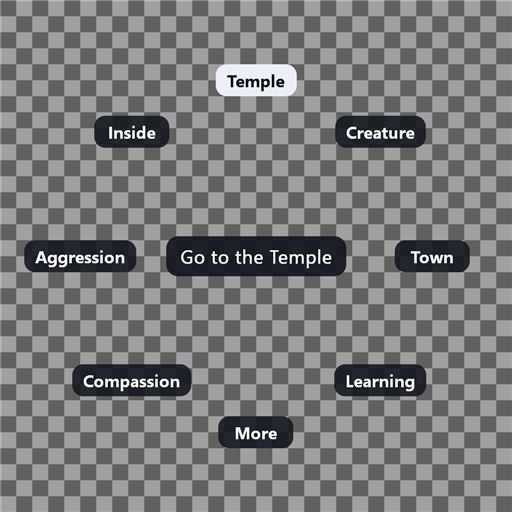

# Motion controllers

This file describes how the Quest controllers (and other OpenXR controllers)
reach the game. It has five parts:

- how the plain game reads the mouse and the keyboard (section 1),
- how the mod reads the controllers through OpenXR (section 2),
- how a controller press becomes a game input (sections 3 and 5),
- the scripted controller for desktop runs (section 4),
- the features of the controllers: the aim ray (8), the game window behind
  (9), the ring (10) and the Temple (11).

The Hand itself is in `hand.md`. The grab of an object is in `grab.md`, the
throw in `throw.md`, the Creature in `creature.md`, the miracles in
`miracles.md`, the village in `village.md` and the model of the Hand in
`hand-model.md`. The list of the controls of the plain game is in
`controls-audit.md`.

All addresses are in `runblack.exe` v1.42, image base `0x00400000`. Marks:
**[V]** read in the disassembly, **[I]** inferred, **[R]** seen in a desktop
run.

## Summary

- The game reads the mouse from three sources. Window messages give the
  pointer position and every button event, including the double click.
  DirectInput gives only relative motion and the wheel. A helper thread uses
  `GetAsyncKeyState` and `GetCursorPos`, but only to post a synthetic move
  message, and the game ignores the button bits in it.
- All button events pass through one function, `LHMouse::SetButtons`
  `0x007E4B80`, and only the window procedure calls it. The mod hooks it and
  merges the real mouse with the controllers there.
- The double click is the Windows one. The window class has `CS_DBLCLKS`, and
  `WM_LBUTTONDBLCLK` becomes event bit `0x10`. Windows makes it only from
  real input. So the mod makes the double click flag itself when it needs one.
- `CImmMouse::SwitchToAbsoluteMode` is not a path. No game code calls it.
- OpenXR input is one action set, created and attached once, right after
  `xrCreateSession`. It syncs once a frame in `BeginFrame`, after
  `xrWaitFrame`. It locates the hands at the predicted display time, in the
  same LOCAL space as the eyes.
- A controller reaches the game in four ways: a mouse button event (the
  trigger and the grip), a pointer position (the aim ray, or the Hand), a
  key in the key buffer (the ring), and a window message (Esc). Each way runs
  inside the game process. The mod never moves the real mouse.
- The mod pumps the controllers once a frame from a hook on
  `AnyWindowMessages`, where the real window messages arrive.
- The default is the direct hand (`controller_hand=1`): the Hand is where the
  controller is, one to one. The pointer mode (`controller_hand=0`) turns the
  aim ray into the pointer of the mouse.
- A scripted controller (`fake_controller`) gives the same data as a
  headset. The desktop test scripts in `bwvr/tools/desk/` use it.

## 1. How the game reads the mouse

### 1.1 The LHMouse object

There is one `LHMouse`, at `0x00E85204`, inside `LHSys::TheSystem`
(`0x00E85040`). Every window procedure call uses `ecx = 0x00E85204`.

| Address | Field | Written by | Meaning |
| --- | --- | --- | --- |
| `0x00E852C0`, `0x00E852C4` | `+0xBC`, `+0xC0` | `LHMouse::UpdateCurrentPos` `0x007E49A0` | The pointer, in window pixels as the game has it. `pointer_map.cpp` makes it render pixels. |
| `0x00E852D4`, `0x00E852D8` | `+0xD0`, `+0xD4` | the same | A copy of the pointer |
| `0x00E852E4`, `0x00E852E8` | `+0xE0`, `+0xE4` | `LHMouse::UpdateDeltaPos` `0x007E4810` | Relative motion from DirectInput, summed |
| `0x00E85300` | `+0xFC` | the same | The wheel from DirectInput, summed, 120 a click |
| `0x00E85304` | `+0x100` | `LHMouse::SetButtons` | The buttons held: bit 1 left, 2 right, `0x40` middle |
| `0x00E85308` to `0x00E8534C` | `+0x104` to `+0x148` | the same | The pointer at each press, release and double click |
| `0x00E85350` | `+0x14C` | the same | The event latch: the button events since a reader last cleared them |

### 1.2 Button events

`LHMouse::SetButtons(uint8 flag)` is `__thiscall`, `ret 4`. It takes the
`LHScreen` critical section, sets `flag` in `+0x100` and in the latch
`+0x14C`, stores the pointer for that event, and clears the opposite bit. The
window procedure `GameWindowProc` `0x007DBF30` calls it 11 times and nothing
else calls it. The jump tables at `0x007DC784` and `0x007DC894` give the
message for each call:

| Message | Handler | Flag | Also |
| --- | --- | --- | --- |
| `WM_LBUTTONDOWN` `0x201` | `0x007DC291` | `0x01` | `SetCapture`, cursor animation timer |
| `WM_LBUTTONUP` `0x202` | `0x007DC311` | `0x04` | `ReleaseCapture` when no button is held |
| `WM_LBUTTONDBLCLK` `0x203` | `0x007DC280` | `0x10` | |
| `WM_RBUTTONDOWN` `0x204` | `0x007DC272` | `0x02` | `SetCapture` |
| `WM_RBUTTONUP` `0x205` | `0x007DC343` | `0x08` | `ReleaseCapture` |
| `WM_RBUTTONDBLCLK` `0x206` | `0x007DC3D2` | `0x20` | |
| `WM_MBUTTONDOWN` `0x207` | `0x007DC39C` | `0x40` | `SetCapture` |
| `WM_MBUTTONUP` `0x208` | `0x007DC3E3` | `0x80` | `ReleaseCapture` |
| `WM_MBUTTONDBLCLK` `0x209` | `0x007DC3C2` | `0x00` | |
| `WM_ACTIVATEAPP` `0x1C` | `0x007DC073` | `0x04`, `0x08`, `0x80` | Releases all three buttons and clears the motion and wheel sums |
| `WM_MOUSEWHEEL` `0x20A` | `0x007DC633` | none | Goes to `DefWindowProcA`. The wheel comes from DirectInput. |

A double click in Windows arrives as down, up, double click, up. The double
click message sets bit `0x10` and does not set the held bit 1. So during the
second press of a double click the game sees no left button held. The mod
copies this exactly when it makes a double click.

The window class asks for double clicks: `RegisterGameWindowClass`
`0x007DBA00` sets the style to `0x0B` at `0x007DBA15`, which is
`CS_VREDRAW | CS_HREDRAW | CS_DBLCLKS`.

### 1.3 Who reads the buttons

| Reader | Address | What it reads |
| --- | --- | --- |
| `BindableAction::IsMouseBeingPressed` | `0x0046F500` | Held bits in `0x00E85304`. For the wheel bindings it moves `0x00E85300` into `0x00C5E8D8`. Called from `ControlMap::ProcessActionsPerformed` `0x00470AB0` for 33 actions. |
| `fn_0046F590`, `fn_0046F5F0`, `fn_0046F660` | | Click, double click and release tests on the latch `0x00E85350`. They clear the bit they use. |
| `CameraModeNew3::Update` | `0x0045ABE4` | Left and right held together (`0x00E85304`), but only when `GetFocus()` is the game window (`0x0045ABDA`). This sets the both button mode at `0x00C5B0B0`. |
| `CameraModeNew3::Update` | `0x0045ABCA`, `0x0045AC69` | `ControlMap::IsActionPerformed` for actions 0, 1 and `0x10` (the middle button) |
| `CameraModeNew3::Update` | `0x0045DDAE` | The double click bit `0x10` in the latch. This is the jump to a place. |
| `CMouse::ProcessButtons` | `0x0061A150` | The latch, then `GGame::ProcessBindableKeys` `0x0063F830`. It clears bits 1, 2, 4, 8, `0x10` and `0x20` at the end. It moves the wheel sum into `0x00C5E8D8`. |
| `FrontEnd::JustDoABox`, the editors, `DoCitadelDraw` | many | The latch and the held bits, directly |

### 1.4 The pointer

The pointer position comes only from window messages:

```
WM_MOUSEMOVE 0x200, handler 0x007DC5A6
  SetEvent(0x00E8C0CC)                  tells the mouse thread a real move arrived
  if [0x00E8C0FA] == 0                  the game's "turn off mouse move" flag
    MouseMoveHandler 0x007DC920 (hwnd, lparam, time)
      LHMouse::UpdateCurrentPos 0x007E49A0     writes +0xBC, +0xC0
      LHMouse::Draw(1, 4) 0x007E57C0
        GGame::MouseHandler 0x0054FFE0          a callback, at most every 28 ms
          CMouse::ProcessPosition 0x0061A110    sends the pointer to the interface
```

The interface keeps its copy at `GInterface + 0x428`. `backend.md`, "One
pointer, not two", describes why that copy must agree with the Hand.

A second source feeds the same path. `MouseInputThreadProc` `0x007DBD10` runs
on its own thread. It waits 40 ms on the event at `0x00E8C0CC`. If no real
move arrived, it reads `GetAsyncKeyState` for the three buttons, Shift and
Ctrl, reads `GetCursorPos`, and posts message `0x8009` with the button bits in
`wParam` and the client position in `lParam`. The window procedure sends
`0x8009` to `MouseMoveHandler` (`0x007DC598`), which ignores `wParam`. So this
thread only repeats the pointer position. It never presses a button. The
thread sleeps while the window is inactive (`gWindowActive` `0x00C311A8`).

The first argument of `MouseMoveHandler` is the window handle, not `wParam`.
`pointer_map.cpp` names it `wparam`. This does no harm, because the hook only
passes it on.

The game also moves the pointer itself through `LHMouse::SetPosition`
`0x007E4E40`. Its callers are `CameraModeNew3::Update` (`0x0045D27E`,
`0x004605B7`), `fn_005D1AB0` and `fn_005DAEE0`.

### 1.5 DirectInput: motion and wheel only

`LHMouse::InitDirectInput` `0x007E48C0` makes one device: `GUID_SysMouse`,
`c_dfDIMouse`, cooperative level 6 (non exclusive, foreground). No other code
touches `gDirectInput` `0x00E90668` or `gMouseDevice` `0x00E9066C`.

`LHMouse::UpdateDeltaPos` `0x007E4810` calls `GetDeviceState` (vtable `+0x24`)
once a frame, with a 16 byte `DIMOUSESTATE`:

- `lX` and `lY` go into `+0xE0` and `+0xE4`. `GGame::ProcessGraphicsEngine`
  copies them to `ControlMap::MouseDelta` `0x00C5E8D0` at `0x0054D868`.
  `CameraModeNew3` copies that to `mode + 0xA8` (`0x0045AC79`). This drives
  the middle button turn, the Ctrl zoom and the Shift tilt. The land drag
  does not use it. It casts the pointer at `mode + 0xB0` (`0x0045D444`,
  `0x0045D456`).
- `lZ`, the wheel, goes into `+0xFC` (`0x00E85300`), unless
  `LHMouse::MouseWheelSkip` `0x00C311A4` is set.
- The button bytes of `DIMOUSESTATE` are never read.

No other input API is imported: no `GetKeyState`, no raw input, no joystick
and no XInput. The keyboard comes from `WM_KEYDOWN`, `WM_KEYUP`,
`WM_SYSKEYDOWN` and `WM_SYSKEYUP` into `LHKeyboard::ProcessKeyboard`
`0x007DCAF0`.

### 1.6 When each part runs in a frame

`GGame::Loop` `0x0054CF20`, one iteration:

```
ControlMap::ProcessActionsPerformed 0x00470AB0    held bits, wheel bindings
GGame::ProcessGraphicsEngine 0x0054D850
  LHMouse::UpdateDeltaPos 0x007E4810              DirectInput motion and wheel
    PointerMapApply (mod, input_watch.cpp)        pointer in render pixels
  ControlMap::MouseDelta <- LHMouse+0xE0          0x0054D868
  GCamera::Update 0x00441F80
    CameraModeNew3::Update 0x0045A960             pointer, held bits, double click, wheel
  GGame::Process3dEngine 0x0054DA80
    XrScreen::BeginFrame (mod, stereo.cpp)        xrWaitFrame, eye poses
GGame::ProcessFrameInputs 0x0054C340
  CMouse::ProcessButtons 0x0061A150               the latch, the wheel sum
GGame::FlipScreen 0x0054D800
  LHScreen::Flip 0x007DE090
    AnyWindowMessages 0x007DB910                  called at 0x007DE1D6
    ProcessWindowMessages 0x007DB940              GameWindowProc runs here
```

Real button events arrive at the end of a frame, on the game thread, and the
next frame reads them. The mod adds controller events at the same point.

### 1.7 CImmMouse::SwitchToAbsoluteMode

This is not a usable path. `SwitchToAbsoluteMode` is slot 10 of the
`CImmMouse` vtable `0x0092AB70`, a thunk to an `IFC22.dll` import. The only
code that uses the object is the Immersion setup at `0x005D86A0`. It calls
`CImmMouse::Initialize` through the import at `0x005D8703` and slot 2 at
`0x005D8719`. Nothing calls slot 10 (`+0x28`). The two import references at
`0x004A63AA` and `0x0060BF9A` sit after a `ret` and are not reachable. The
function would switch a FEELit mouse driver into absolute mode, and that
hardware is not present. The pointer always comes from `WM_MOUSEMOVE`.

### 1.8 What the mod hooks on this path

| Hook | Address | File | What it does |
| --- | --- | --- | --- |
| `AnyWindowMessages` | `0x007DB910` | `controllers.cpp` | The pump: runs `ControllersPump`, then the original |
| `LHMouse::SetButtons` | `0x007E4B80` | `controllers.cpp` | Merges the real mouse and the controllers. The pump calls the original through the trampoline |
| `LHMouse::UpdateDeltaPos` | `0x007E4810` | `input_watch.cpp` | Calls `PointerMapApply` after the original |
| `MouseMoveHandler` | `0x007DC920` | `pointer_map.cpp` | Window pixels to render pixels |
| `LHMouse::SetPosition` | `0x007E4E40` | `pointer_map.cpp` | Render pixels to window pixels |
| `GCamera::Update` | `0x00441F80` | `pointer_map.cpp` | The game's own screen and camera for the camera code |
| `UnprojectScreenPoint` | `0x0081B370` | `pointer_map.cpp` | The exact Hand ray for the camera code |
| `CameraModeNew3::UpdateClickParams` | `0x00459610` | `pointer_map.cpp` | The press ray, and a level drag plane |
| `ControlMap::IsActionPerformed` | `0x00470AF0` | `comfort_camera.cpp` | Hides the middle button, steps the wheel |
| `CameraModeNew3::Update` | `0x0045A960` | `comfort_camera.cpp` | Snap turns, instant jumps, zoom steps |
| `GInterface::StartImmersion` | `0x005D8A10` | `controllers.cpp` | Game effects become haptic pulses |
| `ControlMap::ProcessActionsPerformed` | `0x00470AB0` | `frame_timers.cpp` | Timing only |

`PointerHeld` and `LandDragHeld` in `pointer_map.cpp` read the held bits at
`0x00E85304` while a controller holds a button. That address holds the union
of both sources. With no controller button held, they read the real mouse
with `GetAsyncKeyState`.

## 2. OpenXR input in XrScreen

### 2.1 The session lifecycle

`XrScreen` (`bwvr/src/vr/xr_screen.cpp`) runs on the game thread only.

1. `Start` creates the instance with `XR_KHR_D3D11_enable` only, finds the
   system, makes the device, then calls `xrCreateSession`. It makes the LOCAL
   space and the VIEW space, then the swapchains. Then it creates the input
   (2.4).
2. `BeginFrame` polls events. On `READY` it calls `xrBeginSession`. On
   `STOPPING` it calls `xrEndSession`. On `EXITING`, `LOSS_PENDING` or
   instance loss it sets `running_ = false`. It returns early while the
   session is not running. Then it calls `xrWaitFrame`, checks for a
   recenter, calls `xrBeginFrame`, syncs the actions and calls `xrLocateViews`
   in the LOCAL space at `predictedDisplayTime`.
3. `BeginFrame` runs once per game frame: from `Process3dEngineBody` when the
   scene is drawn (`stereo.cpp`), or from `SubmitTexture` and `SubmitBgra` in
   menus, loading screens and videos (`mod_main.cpp`, `h_FinishFrame`).
4. `Stop` ends the session and destroys the swapchains, the spaces, the
   session, the device and the instance.

The mod makes one `XrScreen` per process and never makes a second one after
the session is lost.

### 2.2 The action set

One action set, `play` ("Play"), priority 0. Every action has the two
subaction paths `/user/hand/left` and `/user/hand/right`, so one action
serves both hands.

| Action | Type | Use |
| --- | --- | --- |
| `grip_pose` | pose | Where the hand holds the controller. The Hand is placed here. |
| `aim_pose` | pose | The pointing ray |
| `trigger` | float | The left mouse button |
| `squeeze` | float | The right mouse button (the grip) |
| `stick` | vector2f | Snap turn, zoom steps, the ring |
| `stick_click` | boolean | The gesture button (`gesture_button=2`), the ring (`radial_menu_button=2`) |
| `primary` | boolean | A on the right hand, X on the left |
| `secondary` | boolean | B on the right hand, Y on the left |
| `menu` | boolean | The menu button |
| `haptic` | vibration output | Short pulses |

Float actions for the trigger and the grip let the mod apply its own
hysteresis. A float action bound to a boolean input reads 0 or 1, so the same
action works on controllers with a click grip.

### 2.3 Bindings

Each path is under `/user/hand/left` and `/user/hand/right` unless the row
says one hand. The mod never binds `/input/system/click`, because the
runtime keeps it. The mod suggests each profile in its own
`xrSuggestInteractionProfileBindings` call. It logs a failure and goes on,
because a runtime can refuse a profile it does not know. The Touch profile
comes first, because Virtual Desktop presents Quest controllers with it.

| Action | `oculus/touch_controller` | `khr/simple_controller` | `valve/index_controller` | `htc/vive_controller` | `microsoft/motion_controller` |
| --- | --- | --- | --- | --- | --- |
| `grip_pose` | `input/grip/pose` | `input/grip/pose` | `input/grip/pose` | `input/grip/pose` | `input/grip/pose` |
| `aim_pose` | `input/aim/pose` | `input/aim/pose` | `input/aim/pose` | `input/aim/pose` | `input/aim/pose` |
| `trigger` | `input/trigger/value` | `input/select/click` | `input/trigger/value` | `input/trigger/value` | `input/trigger/value` |
| `squeeze` | `input/squeeze/value` | none | `input/squeeze/value` | `input/squeeze/click` | `input/squeeze/click` |
| `stick` | `input/thumbstick` | none | `input/thumbstick` | `input/trackpad` | `input/thumbstick` |
| `stick_click` | `input/thumbstick/click` | none | `input/thumbstick/click` | `input/trackpad/click` | `input/thumbstick/click` |
| `primary` | right `input/a/click`, left `input/x/click` | none | `input/a/click` | none | none |
| `secondary` | right `input/b/click`, left `input/y/click` | none | `input/b/click` | none | none |
| `menu` | left `input/menu/click` | `input/menu/click` | none | `input/menu/click` | `input/menu/click` |
| `haptic` | `output/haptic` | `output/haptic` | `output/haptic` | `output/haptic` | `output/haptic` |

### 2.4 Where each call goes

In `Start`, directly after `xrCreateSession` and the LOCAL space:

1. `xrStringToPath` for `/user/hand/left` and `/user/hand/right`, and for
   every binding path in the table. Paths belong to the instance.
2. `xrCreateActionSet`, then `xrCreateAction` for each action. All actions
   must exist before the first attach, because `xrCreateAction` fails with
   `XR_ERROR_ACTIONSETS_ALREADY_ATTACHED` after it.
3. `xrSuggestInteractionProfileBindings`, once per profile.
4. `xrAttachSessionActionSets`, once for the session.
5. `xrCreateActionSpace` for `grip_pose` and `aim_pose`, once per hand, with
   the hand as the subaction path and an identity pose.

A failure in these steps does not fail `Start`. The screen works without
controllers, so the code logs the reason, sets `input_ready = false` and goes
on.

In `BeginFrame`:

1. In the event loop, `XR_TYPE_EVENT_DATA_INTERACTION_PROFILE_CHANGED` calls
   `xrGetCurrentInteractionProfile` for each hand and logs the profile.
2. The code keeps the session state. Input is live only in
   `XR_SESSION_STATE_FOCUSED`.
3. Before the early return for a session that is not running, the code clears
   the hands, so a sleeping headset cannot leave a button held.
4. After `xrWaitFrame`, `xrSyncActions` runs with the one action set.
   `XR_SESSION_NOT_FOCUSED` is a success code. Then every action reads
   inactive, and the hands read as released.
5. For each hand, the code reads the float, vector and boolean states with the
   hand as the subaction path. It calls `xrLocateSpace` for the aim and grip
   spaces in the LOCAL space at `predictedDisplayTime`. That is the same space
   and the same time as `xrLocateViews`, so the hands and the head share one
   moment.

Haptics use `xrApplyHapticFeedback` with the `haptic` action and the hand as
the subaction path. It works whenever the session runs, and returns
`XR_SESSION_NOT_FOCUSED` when it cannot act.

`Stop` destroys the four action spaces before the session, and the action set
(which destroys its actions) before the instance.

### 2.5 Session restart and focus

- `STOPPING` then `READY` keeps the same `XrSession`. The attached action set
  and the action spaces stay valid, so nothing is made again. The code clears
  the hands while the session is not running.
- The menu of Virtual Desktop makes the session `VISIBLE`, not `FOCUSED`.
  `xrSyncActions` then returns `XR_SESSION_NOT_FOCUSED`, and the mod releases
  every controller button it holds.
- A focus loss reads every button as up. So a trigger held through it, for
  example to click Resume in the headset menu, reads as a new press on the
  first focused frame. When the pointing hand becomes active again, the pump
  sets `need_up` for the trigger and the grip if they read down. The A
  button, B, the menu button and the stick click make no event on that
  frame. A trigger or grip that goes down while the hand cannot act (a menu,
  a loading screen, the game behind another window) must also go up before it
  can press.
- A recenter changes the LOCAL space. The hands are located in it each frame,
  so they follow it with no extra work. `head_pose.cpp` recenters its own
  origin, and the hands use that same origin (2.7).
- The paths, the action set and the actions live as long as the instance. The
  attach and the action spaces are per session.
  `xrSuggestInteractionProfileBindings` cannot be called again after any
  attach on that instance.

### 2.6 What XrScreen gives

Public, in `xr_screen.h`:

```cpp
// One hand, as the runtime reported it at the display time of the last
// BeginFrame. Poses are in meters, in the same LOCAL space as EyeView.
struct HandInput {
  bool active;               // bound, and the session has input focus
  bool aim_valid;            // position and orientation both valid
  bool grip_valid;
  bool aim_tracked;          // tracked, not inferred
  bool grip_tracked;         // the same for the grip pose
  float aim_position[3];
  float aim_orientation[4];  // x y z w
  float grip_position[3];
  float grip_orientation[4];
  float trigger;             // 0 to 1
  float squeeze;             // 0 to 1
  float stick[2];            // -1 to 1, x right, y forward
  bool stick_click;
  bool primary;              // A or X
  bool secondary;            // B or Y
  bool menu;
  uint64_t serial;           // one more on every sync
};

const HandInput& hand(int index) const;   // 0 left, 1 right
const char* HandProfile(int index) const; // "" when nothing is bound
bool InputFocused() const;
void Haptic(int index, float amplitude, float seconds);
```

`bwvr/src/xrtest/main.cpp` prints both hands once a second. It tests the
controllers in the headset with no game.

### 2.7 The controller in game world units

The head goes into the game in two steps, and a hand takes the same two
steps. Otherwise a controller at the head does not show at the head.

Step one, `HeadPoseForEye` in `head_pose.cpp`: relative to the captured
origin, which keeps only a yaw.

```
q_rel  = conj(origin_yaw) * q                          rotation in the room
M      = FlipHandedness(ToMatrix(q_rel))               left handed
local  = rotate(conj(origin_yaw), p - origin_position)
t      = (local.x, local.y, -local.z) * units_per_meter    7.5 by default
```

Step two, `h_UpdateCamera` in `head_camera.cpp`: into the world through the
room basis `L` (world up and the game camera's heading):

```
render rotation  R   = L * H
render position  E   = game_position + L * t_head
```

For a hand, the mod applies step one to its pose, then places it relative to
the rendered eye:

```
hand position   = E + L * (t_hand - t_head)
hand rotation   = L * M_hand
aim ray         = hand rotation * (0, 0, 1)           OpenXR -Z forward, flipped
```

The aim orientation gets one more turn before this step (section 8).

`t_head` is the raw translation of the head, before the rotation only mode
sets it to zero. With full six degrees of freedom this is the same as
`game_position + L * t_hand`. With the rotation only mode it still keeps the
hand at the right place relative to the eye. A hand at the head center gives
`t_hand = t_head`, so it sits at `E`.

`head_pose.cpp` has two functions for this:

```cpp
// A pose in the room, with the same origin and scale as the head, and no
// origin capture. False until the head has captured an origin.
bool HeadPoseToRoom(const float position[3], const float orientation[4],
                    float rotation_out[9], float translation_out[3]);
// The head center of this frame in the same frame, before rotation only.
bool HeadPoseHeadInRoom(float translation_out[3]);
```

`HeadPoseToRoom` never captures the origin. Only the head does that, so a
controller can never become straight ahead.

Timing: the head pose of `BeginFrame` N is what the camera uses in frame N+1.
The hands are located in the same `BeginFrame`, so the pointer in frame N+1
uses a hand and a head from the same moment. The one frame age is the same
one that the mouse lock has.

`E`, `H` and `t_head` must come from one head sample. The render position of
the frame that is drawn now has the lean of the frame before, and `t_head` is
from this frame. So `controllers.cpp` builds `E = game_position + L * lean`
from `HeadPoseCurrent` (`EyeFromLean` in `controller_math.h`), which is where
the next frame renders from. With full six degrees of freedom `lean = t_head`,
and a hand that stays still in the room stays still in the world when the
head moves.

## 3. The controller as a pointer

The pointer mode is `controller_hand=0`. It also runs with the direct hand
while a dialog box is up (3.6) and in the rooms of the Temple (section 11).

### 3.1 The mapping

The mod turns a render pixel into the exact world ray of the Hand (`HandRay`
in `pointer_map.cpp`): `world = L * H * screen_ray(pixel)`. For the
controller it runs this backward.

1. Take the aim ray in the world (2.7): origin `A`, direction `D`.
2. Pick the target `T = A + s * D`. See 3.2 for `s`.
3. Put `T` into the render camera: `c = transpose(H) * transpose(L) * (T - E)`.
4. If `c.z` is 0.05 or more, the render pixel is
   `x = (1 + c.x * fx / c.z) * hx` and `y = (1 - c.y * fy / c.z) * hy`, with
   `hx`, `hy`, `fx`, `fy` from `bw::tech::InfoTransform`. This is the exact
   inverse of `ScreenRay` in `pointer_map.cpp`.
5. Set `g_true_x` and `g_true_y` to that pixel in `PointerMapApply`, instead
   of the mouse motion.

Everything downstream is the path of the mouse. `PointerMapApply` writes the
globals and moves the Windows cursor, so `WM_MOUSEMOVE` and the `0x8009`
message of the thread give the interface the same point through
`h_MouseMoveHandler`. `h_GCameraUpdate` turns the float pixel into the ray of
the Hand and the game screen point. `h_Unproject` gives the camera code the
exact ray. So the Hand, the interface, the land drag and the double click
jump all use one pointer.

The mod does not also feed the camera code a ray taken straight from the
controller. If the pixel is clamped, the Hand and the drag would then use two
different rays (`backend.md`, "One pointer, not two"). The direct hand is the
one exception: its camera code rays go from the game camera to the target of
the Hand, so a lean of the head does not slide the land. See `hand.md`.

`LockToRoom` is skipped while the controller owns the pointer. The aim ray is
fixed in the room, and a head turn changes its pixel through `H` in step 3.
`LockToRoom` would turn it a second time. It still records the head each
frame, so that the mouse does not jump when it takes over again.

### 3.2 Parallax and the projection depth

The aim ray starts at the hand, not at the eye. The game casts the ray of the
Hand from the eye, through the pixel. The two rays meet at `T` only. If the
land under the Hand is at a different depth, the Hand lands a little off the
line of the controller.

The error is the offset of the hand from the eye, across the ray, times the
difference of the inverse depths. The hand is about 0.4 m from the eye, 3
units at 7.5 units a meter. With `s` at the default focus distance of about
150 units:

| Land at | Error |
| --- | --- |
| 50 units | about 2.4 degrees |
| 150 units | 0 |
| 1000 units | about 1 degree |

`s` is the distance from `E` to the focus of the game camera
(`HeadCameraGameCamera`). The focus is on the land in the middle of the view
of the game, which is where the player works. In a dialog box and in a room of
the Temple, `s` is the depth of the thing (3.6 and 11.2).

An exact method is open: march the aim ray against the land and use the hit.
`LH3DIsland::GetAltitude` `0x00803090` is `__fastcall` with a map coordinate in
`ecx` and returns a float. It has 713 callers. The layout of `LH3DMapCoords`
is still open: the function reads cell indices as shorts at `+2` and `+6` and
rejects values outside 0 to 511. `GCamera`'s constructor (`0x004418B4`) shows
one caller.

### 3.3 Off screen and behind the head

The render covers the whole headset view, about 110 degrees across. So a ray
at anything the player can see gives a pixel inside the render.

- **Past the edge of the render.** `PointerMapApply` clamps the pixel to the
  render. The Hand stops at the edge of the view and does not follow the
  controller. This is the same as a mouse at the edge.
- **Behind the head**, `c.z` below 0.05. There is no pixel. The mod keeps the
  last pixel, as `LockToRoom` does, and marks the pointer as off view.
- **A press that starts off view** does not reach the game. The mod drops it
  and sets `need_up`: the button must go up before it can press again. A
  press held back and sent later would start a land drag at the edge of the
  view while the hand still moves. With the direct hand, a hand below or
  beside the render is off view. A release always goes through.
- **The sky.** A ray above the horizon gives a pixel in the sky. The game
  handles that as it does for the mouse.

### 3.4 What the safe box does

`PlaceGamePoint` in `pointer_map.cpp` exists because the pixel on the own
screen of the game decides what a press does, and the player cannot see that
screen. A press in the side bands (more than 0.45 from the middle) becomes a
turn. A press in the bottom 7 percent or the top 10 percent can become a tilt.
Four rules follow, and they apply more strongly to a controller:

1. The camera code gets a pixel where a press can only mean "grab the land":
   the box from 0.06 to 0.94 across and 0.11 to 0.92 down. A controller
   points anywhere, including far outside the view of the game camera while
   the head looks away.
2. The ray itself travels on a separate path (`h_Unproject`), so the box never
   moves the grab point.
3. During a hold the pixel is not clamped, and `KeepStepLimit` sets its
   distance from the press pixel from the angle turned. The drag limits each
   step by that pixel distance.
4. A ray behind the game camera gets a stand-in pixel (`kBehindX`,
   `kBehindY`).

The controller feeds the float pixel into this same code, so it gets all four
rules.

### 3.5 Who owns the pointer

The mouse keeps working all the time. One owner at a time:

- The mouse takes the pointer when the Windows cursor moved
  (`cursor != g_written` in `PointerMapApply`), or when a real button event
  reaches the `SetButtons` hook.
- The controller takes it when its aim is valid and its direction turned more
  than 1 degree since the mouse last moved, or when a controller button
  changes. With the direct hand, a move of the grip point of 2 cm in the room
  counts too.
- The aim direction is compared in the room, before `L`. A turn of the game
  camera (the keys, the middle mouse, a fly to or a story camera) is then not
  a turn of a controller that lies still on the desk.
- While a button is held, only the source that pressed it can take the
  pointer. The held buttons of the controller come from the pump. The real
  mouse is read with `GetAsyncKeyState`, as `PointerHeld` reads it. A grip
  that carries an object counts as a held controller button.
- An untracked pose (the runtime infers it) is not motion. The test waits and
  keeps its rest. Until the runtime has reported a pose as tracked once, a
  valid pose counts as tracked.
- The pointer stays where the last owner left it. The log names each change.

`test_keys=1` and Ctrl+F12 cycle the owner: automatic, controller only, mouse
only. This gives an A/B in one run. F11 and F12 are the only keys the mod
reads for itself. Ctrl held with the mouse at rest does not start the zoom of
the game.

The controllers act while the game window is in front. They also act while it
is behind, when the headset session has the focus of the runtime (section 9).
The mouse acts only while the game window is in front. When the window is not
in front, the mod does not call `SetCursorPos` or `ClipCursor`, because that
would take the desktop cursor from the player.

### 3.6 Buttons, double click, wheel and snap turn

**The pump.** The mod hooks `AnyWindowMessages` `0x007DB910` (`cdecl`, returns
`bool`, no arguments). `LHScreen::Flip` calls it once a frame at
`0x007DE1D6`, on the game thread, just before `ProcessWindowMessages`. The
other callers are the start up loop (`0x007DBCB5`, `0x007DBCC1`) and a wait
loop at `0x006422DE`. The hook runs `ControllersPump()`, then the original.
Controller events then arrive where real ones do, and the next frame reads
both.

The pump is safe to run more than once a frame. It compares the buttons the
controller wants with the buttons the mod has applied, and sends only the
difference. It never acts on "changed since last time". This follows the rule
in `backend.md`, "One frame, one head". `ControllersFrame` latches edges
(A, B, Esc, the gesture button) once a frame, so the pump never reads an edge
twice. When the pump has not run for 100 ms (a loop with its own message
handling), the mod releases every controller button.

**The buttons.** The pump calls the original `LHMouse::SetButtons` through the
MinHook trampoline, with `ecx = 0x00E85204`. The trigger is the left button
(flags `0x01` and `0x04`). The grip is the right button (`0x02` and `0x08`).
`controller_swap_buttons=1` exchanges the two. The trigger and the grip press
above 0.55 and release below 0.35. With the direct hand, a closed grip also
opens when its value falls by 30 percent in 3 frames to less than 80 percent
(`grip_fast_open=1`, the default).

**The grip holds** (direct hand only). The game takes an object with one right
click and lets go with a second one. So with `controller_hand=1` the right
button comes from a small machine (`GripStep` in `controller_math.h`) and not
straight from the grip. Closing the grip on an object takes it. Keeping it
closed carries the object, with the right button of the game up. Opening it
lets go: the pump sends the second click, and `hand_direct.cpp` latches the
throw at the opening. With nothing in the Hand, and for a Miracle, the Tug,
the leash and the Creature, the grip is the right button, one to one. A carry
counts as a held controller button for the owner rule. See `grab.md` and
`throw.md`. With `controller_hand=0` the grip is the right button.

**Merging with the real mouse.** The hook on `LHMouse::SetButtons` sees every
real mouse call, because only the window procedure calls it. The mod keeps a
held mask for each source. It passes a call on only when it changes the union
of the two. So a real release while the trigger still holds the left button
does not reach the game, and the other way round. One exception: when the
window loses focus (`WM_ACTIVATEAPP`, or `gWindowActive` goes to 0) and the
headset session does not stand for the front (section 9), the mod passes every
release on and clears the controller mask. A fresh press is then needed.
While no controller button is held, every real mouse event reaches the game
unchanged.

**The double click.** The mod copies Windows. With the pointer mode, a second
press of the trigger within `GetDoubleClickTime()` of the first, with the aim
turned less than 1.5 degrees, sends `0x10` instead of `0x01`. Its release
sends `0x04`. A third press is a plain press again. The grip does the same
with `0x20`. With the direct hand, the trigger and the grip send no double
clicks. The aim test says nothing about where the Hand is there, and a
ratchet of short land drags could read as a double click, which is a jump.
The A button makes the jump.

**The A button, the teleport** (`teleport.cpp`, `god-view.md`, "The
teleport"). With `teleport=1` (the default) and the head on the camera, A
sends no mouse event. A press of A gives the controller the pointer. Hold A
to aim. The arc leaves the aim pose of the pointing hand. Let go of A to go
to the ring on the land. B while A is down cancels. B is claimed: while A is
down and no gesture is being drawn, a press of B must go up before it draws
(`LatchGesture`), so a cancel starts no gesture. A press of A while a gesture
is drawn is refused.

With `teleport=0`, or when the head is not on the camera (play mode 1), A
sends a whole double click (down, up, double click, up) over four pumps, as a
one button "jump there". It does that only while no source holds the left
button and no grab holds the world. The jump is the jump of the game: it goes
to the object or the land under the Hand.

**The second face button.** B (Y on a left handed player's pointing hand) is
the gesture draw button (`gesture_button=1`, default). `gesture_button=2`
uses the stick click, and 0 turns the draw off. See `miracles.md`. While a
miracle is in the Hand, a short press takes the miracle out of the Hand: at
most `miracle_cancel_ms` (400 ms) and 5 cm of hand motion. A longer press, or
a press with motion, draws a gesture. While A holds a teleport, B cancels the
teleport and not the miracle. While the Hand carries a one-off seed, the
trigger makes the seed active and does not reach the game. While the grip is
closed with a miracle that needs a circle, the path of the hand goes to the
game as it does for the draw button. See `miracles.md`.

**Esc** (`PumpEsc` in `controllers.cpp`). Y on the left controller sends the
Esc key of the game, and so does the left menu button when the runtime gives
it to the game. A left handed player (`controller_left_handed=1`) has the
pointing hand on the left, and its Y is the gesture draw button. So B on the
right hand sends Esc then. It is the second face button of the hand that does
not point, so it never clashes with the draw button or with the B of the
teleport.

The game reads the keyboard only from window messages. The window procedure
passes `WM_KEYDOWN` and `WM_KEYUP` to `LHKeyboard::ProcessKeyboard`
`0x007DCAF0`, which keeps one byte for each scan code and uses bit 24 for an
extended key and bit 31 for a release. The pump sends the two messages with
`SendMessageA` to the game window, from the game thread, with scan code 1. The
key stays down for 60 ms so that a frame sees it, then goes up. One press is
one Esc. A press while the key is down is dropped. The message goes to the
window of the game itself, so the key arrives with the window behind too
(section 9). The press is dropped only when the game window is behind and the
headset session does not stand for it. A button that is already down when a
hand wakes is not a press. The menu does not close with a second Esc:
`MainMenu::CanESCOut` returns false. The player closes it with "Continue
Game". Esc goes by a window message and not by the key buffer, because
code outside `GGame::ProcessKey` reads the last key `0x00E85474` for Esc (the
logo screens, the video before the intro, and five more loops), and the key
buffer does not set it. The window message sets the byte of the key and the
last key, and it puts the key in the buffer through the handler of the game.

**A dialog box takes the pointer.** While `SetupBox::GetCurrentActiveBox`
`0x00407ED0` returns a box (it reads `0x00C4CD20`), the direct hand steps
aside, because the Hand cannot reach the buttons of a box well. The pointing
hand then works as with `controller_hand=0`: the aim ray picks the render
pixel, the trigger is the left button, and the grip is the right button with
no hold. The double click of the pointer mode is back for the trigger and the
grip. `DirectHandNow` is the one switch. It is false while a box is up, so
`ControllerRenderPixel`, `ControllerDirectHand`, `ControllerDirectMotion` and
`ControllerCameraRay` give the ray, and the grip machine is off.
`hand_direct.cpp` needs no change: when `ControllerDirectHand` says no, the
game places the Hand. When the box closes, the direct hand comes back on the
next frame. A thin ray (2 mm, warm white, `BuildMenuRay` in `overlay.cpp`)
leaves the aim pose and shows where the hand points. It draws while the
controller owns the pointer, also with `overlay=0`. The mouse is not changed:
it still takes the pointer when it moves.

**The depth of the menu.** The game draws a menu in screen space and moves it
by the interface shift (`ui_shift_px`, adaptive, 8 to 24 pixels): to the right
in the left eye and to the left in the right eye. The two images fuse at one
depth in front of the eyes:

    z = fx * hx * separation / (2 * shift)

(`aim_smooth.h`, `MenuDepth`. `fx` is `inv_half_tan_fov_x`, `hx` is half the
render width, and the separation and the shift are those of the last frame,
`StereoUiDepthNow`.) The hand is not at the eye, so a pixel from a far point
of the ray is not the place where the ray meets the menu that the player sees.
So `Compute` finds the point where the aim ray meets the plane at the forward
depth `z` of the head (`RayToDepth`). That distance is the `s` of
`RenderPixel`, so the cursor pixel is the view of that point from the middle
of the eyes. The ray is drawn from the aim point to the same point. In each
eye the game draws the cursor shifted by the same pixels as the menu, so the
end of the ray and the cursor are at one place in both eyes. When the ray
does not go forward, the focus distance and a ray of 2 m stay. The mouse does
not use any of this. The log line "the menu ray meets the menu at" shows the
distance and the pixel.

**The wheel.** The stick forward past 0.7 adds 120 to `0x00E85300`, the
DirectInput wheel sum, and the stick back adds -120. Positive counts zoom in
(`comfort_camera.cpp`, `SetWheelScale`). The pump repeats this every 250 ms
while the stick stays out. The stick must come back below 0.3 to reset. From
there the game's own path takes over: `BindableAction::IsMouseBeingPressed` or
`CMouse::ProcessButtons` moves the sum to `0x00C5E8D8`, and
`comfort_camera.cpp` makes the steps (section 5.4). Only the game thread
writes `0x00E85300`, so there is no race with `UpdateDeltaPos`. In the God
view the stick does not use the wheel: one push is one zoom step of the view.

**Snap turns.** The stick to the side past 0.7 asks for one turn. The stick
must come back below 0.3 before the next one. `ComfortCameraRequestTurn(int
direction)` in `comfort_camera.cpp` sets a pending direction that
`h_ModeUpdate` uses like a key press. So `MayTurn`, the turn switch of the
tutorial and the help callback all still apply.

**Haptics.** A 15 ms pulse at 0.25 follows each press the pump sends, and
each snap turn, when `controller_haptics=1`. `h_StartImmersion` routes the
effects of the game (`GInterface::StartImmersion` `0x005D8A10`) to pulses
(`haptics.cpp`). Each game effect has its own strength and length.
`controller_haptics=0` turns all pulses off.

## 4. The fake controller for desktop tests

The fake head (`head_pose.cpp`) builds the pose the runtime would report, and
the rest of the path is the same. A fake controller does the same for a hand.
It needs the desktop rig from `backend.md`, "A headset is not needed to test
most of this", with `fake_head=1`. The origin of the fake head is identity at
zero, so a fake hand in LOCAL space is a hand in the room.

The fake hand stands still. It changes only in discrete steps, like the sweep
of the fake head. There is no continuous motion, not even as a test aid. The
word `pull` is the one step that takes several frames, and it has a fixed end.

The scripts in `bwvr/tools/desk/` use these keys and words.

### 4.1 The keys

| Key | Default | Meaning |
| --- | --- | --- |
| `fake_controller` | 0 | 1 makes a right hand, 2 makes both hands |
| `fake_controller_right_cm` | 20 | Where the aim pose and the grip pose sit, from the head center, in the room. The left hand of a pair is the mirror image |
| `fake_controller_up_cm` | -30 | |
| `fake_controller_forward_cm` | 35 | Positive is forward, so LOCAL z is minus this |
| `fake_controller_yaw` | 0 | Degrees. Positive turns left, as `fake_head_yaw` does |
| `fake_controller_pitch` | -30 | Degrees. Negative points down |
| `fake_controller_roll` | 0 | Degrees |
| `fake_controller_sweep` | 0 | 1 alternates between the pose above and the second pose, once a report window, like `fake_head_sweep` |
| `fake_controller_sweep_yaw` | 20 | The second pose. 20 degree steps stay inside the checks that the pointer code already has |
| `fake_controller_sweep_pitch` | -30 | |
| `fake_controller_script` | empty | Timed inputs. See 4.2 |
| `fake_controller_points` | empty | Hand positions for the word `point`: `right,up,forward` in cm, separated by spaces (16 at most) |
| `fake_controller_left_points` | empty | The same for the word `lpoint` and the left hand. Not mirrored: -20 is 20 cm to the left of the head |
| `fake_controller_rots` | empty | Turns for the word `rot`: `yaw,pitch,roll` in degrees, separated by spaces. A test key, read from `bwvr.ini` |
| `fake_controller_turns` | empty | Turns for the word `aimturn`: `yaw,pitch,0` in degrees, yaw to the left and pitch up. A third number that is not 0 makes the two angles the aim itself and not a turn. A test key |
| `fake_controller_gestures` | empty | Template numbers of `Data\Gestures.jty` for the word `trace`, separated by spaces |
| `fake_controller_gesture_cm` | 30 | The side of the square for `trace`, in front of the head, 5 to 200 |
| `fake_controller_play_frame` | 0 | See 4.3. A test key |
| `fake_controller_front` | 0 | 1 lets the fake controller act while the game window is not in front, also with `controller_window_behind=0`. The fake controller already stands for a headset session that has the focus of the runtime (section 9), so the key is rarely needed |
| `fake_head_right_cm`, `fake_head_up_cm`, `fake_head_forward_cm` | 0 | A still lean of the invented head. The words `lean` and `look` use it |

The code reads the angles and the offsets through `int` first, because
`GetPrivateProfileIntA` returns an unsigned value. The launcher removes the
`fake_*` keys that it knows when it saves (`kRetiredKeys` in `launcher.cpp`),
so a player never keeps test state.

The fake mouse (`fake_mouse_script`, `fake_mouse_step_px`,
`fake_mouse_x_pct`, `fake_mouse_y_pct`, `fake_mouse_x2_pct`,
`fake_mouse_y2_pct`) moves the pointer and presses the left button inside the
mod. Its words are in `god-view.md`, section 10.

### 4.2 The script

The script is a list of `input@frame+frames`, separated by spaces. The input
is a word from the table. `frame` is the frame at which it starts. `frames` is
how many frames it lasts. The mod counts frames from the first frame of the
controllers (one for each frame that draws the world). A word that does not
parse is logged and skipped. The script has 64 words at most and 1023
characters at most.

```ini
fake_controller=1
fake_controller_script=trigger@300+60 pose2@330+1 trigger@500+4 trigger@512+4 stick_right@700+10 stick_up@800+10 a@900+4
```

This holds the land and steps the hand while held, makes a double click 12
frames apart (133 ms at 90 fps), turns once and zooms once.

The words that hold a button (or the stick at full) for `frames` frames:

| Word | Input |
| --- | --- |
| `trigger`, `grip` | Trigger, grip of the right hand |
| `a`, `b` | A, B of the right hand |
| `menu` | The menu button of the right hand |
| `stick_click` | The stick click of the right hand |
| `stick_left`, `stick_right`, `stick_up`, `stick_down` | The stick of the right hand at full |
| `x`, `y` | X, Y of the left hand (needs `fake_controller=2`). Y sends Esc |
| `lgrip`, `ltrigger` | Grip, trigger of the left hand |
| `lstick_left`, `lstick_right`, `lstick_up`, `lstick_down` | The stick of the left hand at full. Two words at the same time give a diagonal |
| `nofocus` | The headset session has no focus of the runtime. Both fake hands are not active, as `XrScreen` gives them then |

The words that act on the first frame of the word only:

| Word | What it does |
| --- | --- |
| `pose2` | Moves the right hand to the second pose (`fake_controller_sweep_yaw`, `fake_controller_sweep_pitch`) for the rest of the run |
| `point` | Steps the right hand to the next of `fake_controller_points`. After the last one the list starts again |
| `lpoint` | The same for the left hand and `fake_controller_left_points` |
| `rot` | Turns the right hand to the next of `fake_controller_rots` |
| `seek` | Steps the right hand once onto the nearest holdable object (see `hand.md` and `grab.md`). On the table it first asks for a wider pick, and steps 2 frames later |
| `seekc` | The same for a point on the line to the nearest Creature |
| `touchc` | The same for the body bone of the nearest Creature |
| `nudge` | Steps the right hand 2 cm to the side. The next `nudge` or `slap` steps it to the other side |
| `slap` | The same with 12 cm |
| `trace` | Steps the right hand through the next template of `fake_controller_gestures`: it holds the first pose for 10 frames, so the script can press the draw button, then takes the next still pose every 2 frames. The template holds the corners of the path on a square of side 1. The word puts it on a square of `fake_controller_gesture_cm` in front of the head and adds a point every 8.5 percent of the side. See `miracles.md` |
| `aimfar` | Turns the aim of the right hand to the nearest far target. It turns the ray and not the pose: it takes the turn of the preset and of the trim off the pose (section 8). See `grab.md` |
| `pull` | Steps the right hand 15 cm toward the head center over the frames of the word. The next `pull` steps it back |
| `aimcmd` | Turns the aim to the middle of the body of the nearest object that a Creature command can act on. `command_test_class` names the class. See `creature.md` |
| `aimturn` | Turns the aim by the next step of `fake_controller_turns`. A turn is a step and not a motion. See `creature.md` |
| `aimtemple` | Turns the aim to the next target of `temple_test_targets` (11.6) |
| `lean`, `look` | `lean` holds the lean of `fake_head_*_cm` for the frames of the word. `look` turns the invented head 30 degrees left and 20 degrees down for the frames. With no `lean` word in the script, a lean that is set holds for the whole run |
| `shot` | Saves a picture of both eyes 3 frames later. It moves nothing |
| `deactivate` | The game gets `WM_ACTIVATEAPP` with 0 and `WM_KILLFOCUS`, as when the player clicks a different program. See 9.5 |

The placement of the hand is in cm from the head center. Each pose word sets
the position of the right hand until the next one.

### 4.3 The script after the first story

The first story of a new game ends at a time, not at a frame. So the frame at
which the player gets the Hand changes with the frame rate. The test key
`fake_controller_play_frame=N` fixes this. The steps of the script from frame
N on count from the frame at which the controller first places the Hand after
frame 1000. That frame is N. The steps before N keep their frames, so the
clicks of the start dialog stay where they are. The log gives the shift. The
frame of `aim_test_keys` counts the same way.

The clicks of the start dialog turn the pose of the fake hand. So a preset on
the fake hand must start after the dialog (`aim_test_touch=N`).

## 5. The controls and the keys

### 5.1 What each control does

The pointing hand is the right hand. With `controller_left_handed=1` the
hands change sides. The default mode is the God view (`god-view.md`).

**The pointing hand**

| Control | Behavior |
| --- | --- |
| Pose | The Hand, one to one in place and size (`hand.md`) |
| Grip | The right button of the game: take, carry, let go, throw, stroke, tap, cast (3.6, `grab.md`). A grip closed on a far target and pulled fetches it (`grab.md`) |
| Trigger | The left button: click. A drag on the land moves nothing in the God view. With the leash on the Hand, a Creature command (`creature.md`). With a one-off seed in the Hand, it makes the seed active (`miracles.md`) |
| A | Hold to aim the teleport arc, let go to go there (`god-view.md`). `teleport=0` gives a jump to the object or the land under the Hand |
| B (Y on the left hand) | Hold and draw: a gesture (`miracles.md`). A short press with a miracle in the Hand takes the miracle out. B while A is down cancels the teleport |
| Stick left and right | One snap turn (5.4). In the Temple it turns the player in the room (11.4) |
| Stick forward and back | In the God view, one zoom step of the view. In other views, a wheel click |
| Stick click | The gesture button with `gesture_button=2` |
| Dialog box up | The hand points a ray. The trigger is the left button and the grip the right button (3.6) |
| In a room of the Temple | The hand points a ray. The trigger and the grip both click (11.3) |

**The other hand**

| Control | Behavior |
| --- | --- |
| Grip | Grabs the land: pull to move it across, and up or down, one to one. Both grips turn and scale the land (`god-view.md`, `grab-world.md`). `grab_hand=2` also lets the grip of the pointing hand grab the land when the Hand is empty and over nothing it can hold |
| X (A when the left hand points) | Hold: opens the ring, and the hand picks an item (section 10) |
| Stick | Push: opens the ring. The stick points and the trigger chooses (section 10) |
| Trigger | Chooses an item when the stick opened the ring. No other job |
| Y (B when the left hand points) | Esc (3.6) |
| Menu button | Esc |

### 5.2 Player keys

| Key | Default | Meaning |
| --- | --- | --- |
| `controllers` | 1 | Use tracked controllers when the headset has them |
| `controller_left_handed` | 0 | 1 points with the left hand |
| `controller_swap_buttons` | 0 | 1 makes the grip the left button and the trigger the right |
| `controller_haptics` | 1 | Short pulses on presses and turns |
| `controller_hand` | 1 | 1 puts the Hand at the controller (the direct hand). 0 keeps the pointer mode of section 3. In the launcher as "Hand" |
| `grip_fast_open` | 1 | With the direct hand, a closed grip also opens on a fast fall of its value (3.6) |
| `gesture_button` | 1 | The gesture draw button: 0 off, 1 the second face button of the pointing hand, 2 the stick click |
| `gesture_size_cm` | 30 | This much hand motion is a third of the view height to the game |
| `teleport` | 1 | 1: A makes the teleport. 0: A makes a jump |
| `miracle_cancel_ms` | 400 | The longest press of the second face button that takes a miracle out of the Hand |
| `controller_hints` | 1 | 1 shows the controller words in the hints and the help text of the game while a controller owns the pointer. 0 leaves every hint as the game draws it (`controller-hints.md`) |
| `hint_profile` | (none) | A test key. Forces the words of one profile, for example `valve/index_controller` |
| `controller_window_behind` | 1 | Section 9. Not in the launcher |
| `aim_preset` | 2 | Section 8 |
| `aim_pitch_deg`, `aim_yaw_deg` | 0, 0 | Section 8 |
| `radial_menu` | 1 | Section 10. The other keys of the ring are in 10.5 |
| `temple_pointer`, `temple_click`, `temple_camera_follow`, `temple_camera_drag`, `temple_pointer_depth_cm`, `temple_turn`, `temple_taps` | see 11.6 | Section 11 |
| `snap_turn` | 2 | 5.4 |
| `zoom_step` | 2 | 5.4 |

The other keys of the Hand (the reach, the size, the throw, the Creature) are
in `hand.md`, `throw.md` and `creature.md`. The keys of the grab of the world
are in `grab-world.md`.

### 5.3 Files and functions

| File | What |
| --- | --- |
| `bwvr/src/vr/xr_screen.h`, `.cpp` | `HandInput`, `hand()`, `HandProfile()`, `InputFocused()`, `Haptic()`, the actions and the bindings |
| `bwvr/src/xrtest/main.cpp` | Prints both hands once a second |
| `bwvr/src/mod/controllers.cpp`, `controllers.h` | The source (real or fake), the room transform, the pump, the merge hook, the aim, the report |
| `bwvr/src/mod/controller_math.h` | The pure math: the transform, the grip levels, the grip machine |
| `bwvr/src/mod/aim_math.h`, `aim_smooth.h` | The aim ray (section 8) and the depth of the menu |
| `bwvr/src/mod/head_pose.cpp` | `HeadPoseToRoom`, `HeadPoseHeadInRoom`, the invented head |
| `bwvr/src/mod/pointer_map.cpp` | The controller pixel in `PointerMapApply`, the owner rule, the held bits, the focus rules |
| `bwvr/src/mod/comfort_camera.cpp` | `ComfortCameraRequestTurn`, the zoom steps |
| `bwvr/src/mod/radial_menu.cpp`, `radial_menu_math.h` | The ring (section 10) |
| `bwvr/src/mod/temple.cpp`, `temple_math.h` | The Temple (section 11) |
| `bwvr/src/mod/teleport.cpp` | The teleport |
| `bwvr/src/mod/haptics.cpp` | The pulses |
| `bwvr/src/mod/mod_main.cpp` | The ini keys, `ControllersInstall`, `ControllersSetScreen` |
| `bwvr/src/mod/stereo.cpp` | The report line, the Ctrl+F12 switch |
| `bwvr/src/launcher/launcher.cpp` | The `fake_*` keys in `kRetiredKeys` |

The main functions of `controllers.cpp`:

```cpp
void ControllersSetOptions(bool on, bool left_handed, bool haptics,
                           bool swap_buttons);
void ControllersSetFake(const FakeControllerSettings& fake);
void ControllersSetScreen(bwvr::XrScreen* screen);
void ControllersInstall();     // hooks SetButtons and AnyWindowMessages
void ControllersPump();        // once per Flip, from the AnyWindowMessages hook
void ControllersFrame();       // once per drawn frame
// For pointer_map.cpp: the render pixel of the pointing hand, false when
// there is none, and whether the ray is off view.
bool ControllerRenderPixel(float* x, float* y, bool* off_view);
bool ControllerMoved();        // turned more than 1 degree since last asked
void ControllersReport();      // once a report window
```

### 5.4 The comfort camera

A camera motion that the player did not make can make a person ill in a
headset. `comfort_camera.cpp` replaces the three motions of the game that do
this.

| Motion of the game | What the mod does | Key |
| --- | --- | --- |
| The middle mouse turns and tilts smoothly | A turn key, a drag with the middle mouse, or a push of the stick turns the heading by one step in one frame. The position stays. The middle mouse does not tilt | `snap_turn`: 0 off, 1 30 degrees, 2 45 degrees (default), 3 90 degrees |
| A double click flies the camera for about 2.25 s | The flight ends in the same frame | `instant_jumps` (1) |
| After a land drag the camera glides on for about 0.3 s | The camera follows the drag exactly and stops at the release | `camera_glide` (0) |
| A wheel click zooms by a small step | One click changes the distance by a fixed ratio. The first click acts at once. Clicks in the next 150 ms join the next step, three at most | `zoom_step`: 0 the step of the game, 1 small (1.12 times), 2 medium (1.20 times, default), 3 large (1.30 times) |

`blink` (0 off, 1 100 ms, 2 200 ms) shows black for a moment on a jump or a
turn. `script_camera` sets how the camera of a story moves (0 as the game
does it, 1 a cut at the start of each move, 2 a cut at the end).

While a grab holds the world, the snap turns and the wheel are refused. In
the God view the snap turn and the stick push step the God view, and the
game camera goes over the place of the player (`god-view.md`). `backend.md`,
"Moving around", has the camera code.

### 5.5 Tests

The math tests are in `bwvr/test/controller_math/` and run with
`.\dev.ps1 build`. `main.cpp` has the checks of the transform, the aim and the
pixel. `aim_checks.h`, `ring_checks.h` and `temple_checks.h` have the checks of
sections 8, 10 and 11.

Desktop runs use the fake controller with `fake_head=1`. These checks apply:

1. **The hand is at the head.** With the three offsets at 0 and the angles at
   the angles of the fake head, the aim origin is 0.00 units from the eye and
   the pixel is at the middle of the render within one pixel.
2. **Scale.** With `fake_controller_forward_cm=100` and the rest at 0, the
   origin is 7.50 units in front of the eye, along the render forward.
3. **Angle.** A hand pitched 20 degrees down from the eye position moves the
   pixel down by `hy * fy * tan(20 degrees)`.
4. **The head turns, the hand does not.** With `fake_head_sweep`, the pixel
   moves with the head and the aim ray in the world does not.
5. **One pointer.** The pointer of the Hand and the pointer of the interface
   (`GInterface + 0x428`) match (`InputWatchAskPointer`).
6. **Land drag.** A trigger hold, then `pose2` while held. The drag report
   shows one press, one land drag and the exact ray, and the camera moves once,
   at the step.
7. **The mouse still works.** Send relative mouse input with `mouse_event` and
   `MOUSEEVENTF_MOVE`, not `SetCursorPos` (`backend.md`, "Holding the ground
   and turning the head dragged the land"). The owner changes to the mouse.
   While the real left button is held and the script presses and releases the
   trigger, the game sees one press and one release.

In the headset, `xrtest` shows both hands, the profile and every button. In
the game, the Hand follows the controller, and Ctrl+F12 switches the owner
live. Open the menu of Virtual Desktop while the trigger is held: the button
must release. Close the menu with the trigger still down: no press may arrive
until the trigger goes up and down again.

## 6. Risks and known limits

- **Focus.** The game reads the both button mode only when `GetFocus()` is its
  window (`0x0045ABDA`), DirectInput is foreground only, and the mouse thread
  sleeps when the window is inactive. Section 9 has what the mod does for
  each of the three.
- **Trigger and grip together** give the both button mode of the game
  (`0x00C5B0B0`). A player who squeezes the whole controller gets it by
  accident.
- **The game moves the pointer itself** through `LHMouse::SetPosition`. While
  the controller owns the pointer, the next frame puts it back on the
  controller ray. The land drag release and the two interface callers
  (`fn_005D1AB0`, `fn_005DAEE0`) are the places to check.
- **Parallax** of one to three degrees in the pointer mode, until the land
  march exists (3.2).
- **Latency.** The pointer uses the hand from the previous `BeginFrame`, like
  the head. Fast pointing can feel a little behind. The runtime does not
  reproject the Hand.
- **Screens with no scene** (menus, loading, videos: `StereoIdle`) have no
  head camera. The mouse is in charge there.
- **The Vive trackpad** reports a position whenever it is touched. As the
  stick, a resting thumb could turn or zoom. A fix is to require the trackpad
  click for that profile.
- **Virtual Desktop's own buttons.** It can keep the left menu button for its
  own menu.

## 7. Open questions

1. What each button does in each state of the Hand, and whether the trigger
   for the left button and the grip for the right button feel right. The
   glove table in `input-devices.md` is a guide. Only a test in the headset can
   decide.
2. Whether Virtual Desktop reports hand tracking as an interaction profile,
   and which one. The mod binds no hand tracking profile now. A hand tracking
   profile would need a pinch for the trigger and the grip and has no stick,
   so the snap turn, the zoom and the ring would need other inputs.
3. The `LH3DMapCoords` layout, for the exact land march (3.2).
4. Whether the pointer should work in screens with no scene, by a ray against
   the quad that shows the menu.
5. Whether a laser line or a dot at `T` helps in the pointer mode, or whether
   the Hand alone is enough. The mod draws any such mark, not the game.

## 8. The aim ray

The aim pose of the runtime is not a good pointing ray, so the mod turns it.
The code is `UpdateAim` in `controllers.cpp`. The math is in `aim_math.h`.

### 8.1 Why the mod turns the aim pose

The chain of 2.7 takes the aim pose of the runtime and changes only the
frame. The math test proves this with known poses (`aim_checks.h`): an aim
pose with no turn aims along +z of the room, a turn of 90 degrees about +y
aims to the left, and a turn of 30 degrees about +x aims up. The menu ray is
the same ray: `ControllersMenuRay` draws from the aim point along the aim
direction to the depth of the menu.

**What Virtual Desktop gives.** The source of the runtime
(`virtualdesktop-openxr/action.cpp`, `rebindControllerActions`) makes the
grip pose and the aim pose of a Touch controller from poses that its author
recorded from the Oculus runtime. These constants give:

- The aim pose is the controller pose of the Oculus SDK, moved 5.5 cm along
  its forward axis. It has no turn (0.01 degrees in the constants).
- The grip pose is that pose turned 60 degrees about x, at 0, -3, 4 cm.
- So the aim pose is 60 degrees down from the grip pose. The aim point is at
  0, -6.7, -7.4 cm in the frame of the grip, 9.96 cm from the grip point.

SteamVR gives the same relation: its render model files of the Quest
controllers put `openxr_aim` 39.4 degrees down and `openxr_grip` 20.6 degrees
up from the raw pose, 9.96 cm apart. So the three runtimes agree on the aim
pose, and the question is what a good pointer does with it.

**Three pointers on a Touch controller, against that aim pose.**

| Pointer | Toward the other hand | Up | Its point from the aim point | Source |
| --- | --- | --- | --- | --- |
| Meta's Interaction SDK | 6.45 | 0.79 | 0.8 cm to the outside, 0.4 cm lower, 1.8 cm behind (Quest 2: 0.9 cm to the inside, 0.3 lower, 2.4 behind) | `OVRPointerPoseSelector` in `FromOVRControllerDataSource.cs`: `Quaternion.Euler(359.209534, 353.548035, 353.044556)` for the right hand |
| Half-Life: Alyx, the menu pointer | 7.09 | -5.99 | 1.0 cm to the outside, 1.0 cm lower, 0.2 cm behind | `client.dll`: `hlvr_client_ui_hand_pointer_rot_x` 45, `_rot_y` 10, `_pos_z` -2.5, `_forward_offset` -1, on the raw pose of SteamVR |
| SteamVR, the component `tip` | 0 | 2.0 | 1.0 cm to the inside, 0.1 cm higher, 2.0 cm behind | The render model files: 37.4 degrees down from the raw pose |

Two of the three turn the ray 6.5 to 7 degrees toward the other hand. They do
not agree on the pitch.

**The sign and the frame of Meta's 0.79 degrees.** Unity turns about z, then
x, then y, and a positive turn about x takes the forward axis down. The x
angle is 359.21, which is -0.79, so the Meta pointer is 0.79 degrees up. The
roll of 6.96 degrees is about the ray. The local pose is on the controller
anchor of `OVRCameraRig`. [I: the controller pose of the PC SDK has the
orientation of the aim pose, and the anchor of the Unity SDK is taken to be
that same pose. The source of `OVRPlugin` was not read.] The comment in the
SDK says "the Pointer Pose for the active controller model as found in the
official prefabs". It does not name the system menu, and no document of Meta
that was found gives the ray of the Quest system menu. So it is not proven
that the Quest menu uses this pointer.

**Lean.** The turn of the Meta pointer is about the up axis of the
controller. A right hand that points down at the land holds the controller
with its top leaned to the left. Then the turn toward the other hand also goes
down: with a lean of 30 degrees the Meta pointer is 6.0 degrees to the left of
the aim pose and 2.5 degrees lower, and with a lean of 60 degrees 3.9 to the
left and 5.2 lower (checks in `aim_checks.h`).

**The choice.** The default is the Alyx pointer. It has the yaw of two
sources, and it is the one source that is lower than the aim pose. Only a
headset shows which of the three is the ray of the Quest menu. Numpad 5 goes
through them.

### 8.2 What the mod does

Once a frame, before `Compute`, `UpdateAim` makes one aim pose for each hand:
the aim pose of the runtime with one turn in the frame of the controller
(`aim_math::Turned`), from a point that the preset can move
(`aim_math::PresetPoint`). The turn is a yaw about the up axis of the aim
pose, then a pitch about its turned right axis. It has two parts, and their
angles add:

- **The preset** (`aim_preset`): 0 is the ray of the runtime, 1 the Meta
  pointer and 2 the Alyx pointer, with the angles and the points of the
  table. A preset applies to a hand whose profile is
  `oculus/touch_controller`. Each other profile, and the fake controller,
  keeps the aim pose of the runtime, and the log says so. The test key
  `aim_test_touch` makes the fake hand count as a Touch controller.
- **The trim** (`aim_pitch_deg`, `aim_yaw_deg`): for each controller, on top
  of the preset. A positive pitch is up. A positive yaw is toward the other
  hand, so the left hand has the mirror image of the right hand.

**One aim for each user.** `Compute` (the pointer and the menu ray) and
`ControllersTeleportInput` (the teleport arc, the ray of a far grab and the
aim of a Creature command) read the same pose: `g_aim_q` and `g_aim_p`. No
other code reads the aim pose of the runtime as an aim. The code that takes the
aim pose in place of a grip pose, for a runtime with no grip pose, keeps the
pose of the runtime.

**One aim a frame.** `ControllersFrame` makes the aim once, inside the draw of
the frame (`LatchFrameAim`), and `ControllersTeleportInput` gives that aim to
each caller until the next frame. The room of the God view and of the table is
known only inside the draw. A caller outside of it, such as the pump of the
buttons, would get the map of the immersive view. See `creature.md`.

**The menu ray is the aim ray.** `ControllersMenuRay` draws from
`g_point.origin` along `g_point.direction`, which are the aim ray of
`Compute`, to the distance at which that ray meets the depth of the menu. The
pointer pixel is the same point (`RenderPixel`). So the drawn ray is the real
aim ray, and it ends at the cursor.

### 8.3 Keys

| Key | Default | Meaning |
| --- | --- | --- |
| `aim_preset` | 2 | The aim ray of a Touch controller. 0: the ray of the runtime. 1: the Meta pointer. 2: the Half-Life: Alyx pointer |
| `aim_pitch_deg` | 0 | The trim of the pitch in degrees, -30 to 30. A positive value turns the ray up |
| `aim_yaw_deg` | 0 | The trim of the yaw in degrees, -30 to 30. A positive value turns the ray toward the other hand |

**The trim keys.** With `test_keys=1`, the number pad changes the aim while
the game runs (the number pad needs Num Lock on, and Ctrl must be up). A short
pulse of the pointing hand and a log line answer each press. The game binds no key of the
number pad: `ControlMap::LoadDefaults` (`0x0046F890`) has no scan code from
`0x47` to `0x53`.

| Key | What it does |
| --- | --- |
| Numpad 8, Numpad 2 | The ray turns 1 degree up, or 1 degree down |
| Numpad 4, Numpad 6 | The ray turns 1 degree to the left, or to the right, as the pointing hand sees it |
| Numpad 5 | The next preset: from the Alyx pointer to the ray of the runtime, to the Meta pointer, and back. The log line names the preset. The trim stays on top |

The keys change the aim for this run only. To keep it, write the three values
of the last log line to `bwvr.ini`.

Test keys for desktop runs: `aim_test_keys=N` (with `test_keys=1`): from frame
N one key acts every 30 frames, in the order 5, 5, 5, 8, 4, 4, 2, 2, 6.
`aim_test_touch=N`: the fake hand counts as a Touch controller from frame N.
`fake_controller_play_frame=N`: see 4.3. The script word `aimfar` turns the
ray of the fake hand to the object, and not its pose, so a far fetch runs with
each preset.

### 8.4 The log

```
controllers  : aim_preset=2: on a Touch controller the aim ray is the Half-Life: Alyx pointer, 7.09 degrees toward the other hand and 5.99 degrees down from the aim pose of the runtime. The trim is pitch 0.00 and yaw 0.00 degrees (...)
controllers  : right hand "oculus/touch_controller": the runtime puts the aim pose 60.0 degrees down, 0.0 degrees to the left and with a roll of 0.0 degrees from the grip pose. The aim point is at 0.0 -6.7 -7.4 cm in the frame of the grip (x right, y up, z back), frame 212
controllers  : numpad 5: aim_preset=1, the Meta pointer. The trim is aim_pitch_deg=0.00 and aim_yaw_deg=0.00. [...]
```

The second line is what the runtime gives: the aim pose seen from the grip
pose, for each hand. The mod writes it at the first tracked frame of a hand,
and again when an angle changes by more than 1 degree or the point by more
than 5 mm (12 lines at most). The angles and the point in the line of a key
come from the two poses of that frame, not from the settings.

### 8.5 Tests, and what needs the headset

The math test (`aim_checks.h`) covers the chain with known aim poses, the Meta
turn against the forward axis of Meta's Euler angles for each hand, the Alyx
turn and its point from the cvars and the aim pose of SteamVR, the mirror
image for the left hand, the turn with a controller that leans, the point of
each preset, the sum of the preset and the trim, the order of the presets, the
limits of the trim, the grip to aim facts of Virtual Desktop's constants (60
degrees down, 0, -6.73, -7.35 cm), and when the log says the line again.

Desktop runs show that the trim and the presets reach the pointer, the far
grab and the Creature commands. Not run: Numpad 5 through the three presets,
and a far fetch and a teleport with a preset (`aim_queue.ps1` has the run,
with `aim_test_touch=700`).

Only a headset shows:

1. The grip to aim line of each hand, which says what Virtual Desktop gives
   for the Quest 3 controllers.
2. Which preset matches the ray of the Quest menu. Open the game menu and the
   Quest menu, compare the two rays, and go through the presets with Numpad 5.
   If the rays still differ, Numpad 8, 2, 4 and 6 change the trim.
3. That the same values fit the left hand as the pointing hand
   (`controller_left_handed=1`).
4. That the halo, the arc and the green halo show where the hand points, at a
   far object, at the land with A, and with the leash on at an object.

## 9. The game window behind

A player in the headset cannot see the desktop. So the controllers must not
depend on which window is in front there.

Windows does not always give the front to a game that a background process
or the launcher starts. A click on a different window or on the taskbar
while the game starts leaves the game window behind. The player then sees
controllers that do nothing, until a click puts the game window in front.

### 9.1 The start of the game [V]

The launcher starts `runblack.exe` with `ShellExecuteExA` and closes its own
window at once (`launcher.cpp`, `Play`). The game imports no function that
takes the front: no `SetForegroundWindow`, `SetActiveWindow`, `SetFocus` or
`BringWindowToTop`. It makes its window and shows it (`ShowWindow` at
`0x007DBB81`), some seconds after the start. Windows gives the front to a new
window only when no other window got input in the time between. The mod does
not take the front by force.

### 9.2 What the game does with its window behind [V]

- `WM_ACTIVATEAPP` (`0x007DC073`) writes `gWindowActive` `0x00C311A8`. On a
  change it clears the key table (255 bytes at `0x00E85374`), calls
  `LHMouse::SetButtons` with the three release flags, and clears the motion
  sums and the wheel sum. `WM_KILLFOCUS` (`0x007DC09B`) does the same and does
  not write the flag.
- `gWindowActive` has two readers only: that handler, and the mouse thread
  (`0x007DBD58`), which sleeps while the flag is 0. The game loop does not
  read it. So the game draws and plays with its window behind.
- The thread posts the message `0x8009` to the game window each 40 ms in which
  no mouse move came (`0x007DBE88`, the window is `0x00E8C0F4`). That message
  and `WM_MOUSEMOVE` are the only callers of `MouseMoveHandler`, which is how
  the interface gets the pointer (1.4). So with the thread asleep and no mouse
  on the window, the interface gets no pointer.
- The game has one focus test that code can reach: `GetFocus()` in
  `CameraModeNew3::Update` (`0x0045ABDA`), for the both button mode. It
  compares with the window at `0x00E85078`. The call goes through the import
  slot `0x008A97F8`. The two other references to that slot (`0x0058A78A` and
  `0x005D155A`) sit after a `ret`, and the thunk at `0x007AECBE` has no
  caller.
- The keyboard and the buttons have no focus test. `GameWindowProc` gives
  `WM_KEYDOWN` and `WM_KEYUP` to `LHKeyboard::ProcessKeyboard`, which sets the
  byte of the key and the last key, and calls `GGame::KeyHandler` `0x0054FF80`.
  That puts the key in the key buffer of the game
  (`GKeyBuffer::AddKeyIfDifferentToPrevious`), when the game takes keys.
- DirectInput is foreground only. `LHMouse::UpdateDeltaPos` then gets an
  error, tries to acquire the device and returns. It does not change the
  wheel sum, so the wheel steps of the stick work.
- The only game code that moves the real cursor is `LHMouse::SetPosition`
  (`LHMouse::SetPositionRel` has no caller), and the mod hooks it.
- A minimized window is a different case: `GGame::Loop` asks
  `LHScreen::IsAppMinimized` (`0x0054D3B1`) and does not draw. The headset
  then gets no new picture. The mod does not change this.

### 9.3 The rule

The headset session stands for the front. While it has the focus of the
runtime (`XrScreen::InputFocused`), the controllers act in the game, with the
game window in front or behind. When the session loses that focus (the menu
of the headset is open, or the headset is off the head), `XrScreen` gives
hands that are not active, and the controllers do not act.
`ControllersFrame` latches the focus of the session once a frame
(`LatchFront`). A latch that is older than 250 ms does not count.

Each input of a controller goes into the game in the process. No other
program gets it, and the real cursor does not move.

| Input | How it gets into the game |
| --- | --- |
| The trigger, the grip, the click of an open grip, the jump of A | `LHMouse::SetButtons`, the original function, from the pump |
| The pointer | The pointer fields of the game (`PointerMapApply`), and the message `0x8009` to the game window, which `h_MouseMoveHandler` maps |
| The stick | The wheel sum `0x00E85300`, the turn request of `comfort_camera.cpp`, the zoom step of the God view |
| Esc (Y, the menu button) | `WM_KEYDOWN` and `WM_KEYUP` with `SendMessageA` to the game window `0x00E85078`. The call runs the window procedure in the process, from the game thread |
| The ring | The key buffer of the game (10.3) |
| The Hand, the far grab, the teleport, the gestures, the Creature commands, the miracle | Code of the mod that asks `Usable` |

The focus has two sides (`RealFocus` and `LogicalFocus` in `pointer_map.cpp`,
`GameInFront` and `ActsBehind` in `controllers.cpp`):

| Side | Who asks for it |
| --- | --- |
| The logical focus: the game window is in front, or the headset session stands for it | `Usable` and `PumpEsc` in `controllers.cpp`. In `PointerMapApply`: the owner of the pointer (`ChooseOwner`), the true pointer, the lock to the room, the pixel of the controller and the write of the pointer of the game. `ClientToRender` |
| The real focus: the game window is the window in front | Each call that touches the cursor of Windows: `ClipCursor` and `SetCursorPos` in `PointerMapApply`, and `SetCursorPos` in `h_MouseSetPosition`. The real mouse: its motion, its motion that is not taken yet, and a button of it that is down (`ChooseOwner`). The keys of the keyboard that the mod reads (F11, F12 and the test keys) |

What this means for each part:

- **The real mouse does not act in a game that is behind.** A cursor that
  moves in a different program does not take the pointer from the controller
  and does not move the Hand. A mouse button that is down there does not stop
  the controller. A mouse move message over the game window gives the game the
  pointer that it has.
- **The real cursor stays.** `h_MouseSetPosition` does not call
  `SetCursorPos` while a different window is in front, also when the camera
  code of the game asks for it.
- **A button that the controller holds stays down** when the game window loses
  the front. The releases of `WM_ACTIVATEAPP` are the real mouse's only while
  the session stands for the front.
- **The mouse thread sleeps.** While `gWindowActive` is 0 and the controllers
  act, `PointerMapApply` posts the message `0x8009` to the game window each 40
  ms (`FeedPointerBehind`), as the thread does. So the interface gets the
  pointer as it does with the window in front.
- **The both button mode.** The import slot of `GetFocus` holds a function of
  the mod (`h_GetFocus`, `PatchFocusTest`). While the controllers act with the
  window behind, its answer is the game window. In each other case it is the
  answer of Windows. When the slot does not hold `GetFocus` at the start, the
  mod leaves it, and the log says so.
- **The game window.** `GameWindow` in `pointer_map.cpp` uses the handle that
  the game keeps (`0x00E8C0F4`), and never a window of a different process.

The mouse and the keyboard of the desktop keep the rule of Windows: they act
in the program in front. So F11, F12 and the test keys need the game window in
front.

### 9.4 The key and the log

`controller_window_behind` (1). 0 makes the controllers act only while the
game window is in front. The key is not in the launcher. The test key
`fake_controller_front` does not need this key.

The log:

- Once: "controller_window_behind=1. While the headset session has the focus
  of the runtime, the controllers act in the game ...".
- One line for each change of the state, with the frame, the program in front
  and its window class (not its title, which can be private): "the game
  window is behind (in front: NAME, window class "CLASS"). The controllers act
  through the headset session. The mouse and the keyboard do not act in the
  game", "The controllers do not act: the headset session does not have the
  focus of the runtime" (or "controller_window_behind=0"), and "the game
  window is in front again". A game that starts in front gives no line.
- "a different program is the active one, so the mouse thread of the game
  sleeps. The mod now posts the pointer message ..." the first time.
- "the both button mode of the camera is on" and "off", for each change.
- Each report window in which the answer of the focus test changed: "the
  camera asked for the keyboard focus N times. M times the game window did not
  have it ...".
- "the menu button is dropped, the game window is behind and the headset
  session does not stand for it".
- The report line of a hand that cannot act starts with "game window behind
  with nothing that stands for it" or "game not in front".

### 9.5 Tests

A desktop run has no headset session. The fake controller stands for a
session that has the focus. Two script words stand for the rest:

- `nofocus@N+M`: for M frames the session has no focus of the runtime. Both
  fake hands are not active, as `XrScreen` gives them then.
- `deactivate@N+1`: the game gets `WM_ACTIVATEAPP` with 0 and `WM_KILLFOCUS`,
  as it does when the player clicks a different program. The mod calls
  `GameWindowProc` `0x007DBF30` with the two messages, so no window changes
  and Windows does not know of it. From then on `gWindowActive` is 0, the
  mouse thread of the game sleeps, and `h_GetFocus` takes the answer of
  Windows as "no window".

The desk scripts start the game from a background process, so the game window
is behind from the start. A run keeps the real cursor and the window in front
as they were. Seen in desktop runs [R]: with `controller_window_behind=1` the
controller takes the pointer, the clicks of the start dialog work, `nofocus`
stops the presses, the trigger and the grip together give the both button
mode, a land drag and Esc work after `deactivate`. With
`controller_window_behind=0` no press reaches the game and the menu button is
dropped.

Not proven on the desktop: `XrScreen::InputFocused` itself in a session (the
fake controller stands for it), a real `WM_ACTIVATEAPP` from Windows, and a
take of an object in the `deactivate` state.

Needs the headset: start the game, click a different window on the desktop,
and put the headset on. The hands, the grip, the trigger, the stick and Y must
act. Open the menu of the headset: nothing may act in the game until it
closes. The log then names the program that was in front.

## 10. The ring

The plain game has functions that need the keyboard: go to the Temple, go to
the Creature, pause, bookmarks and more. `controls-audit.md` lists them. The
ring holds those functions on the hand that does not point.

The code is `radial_menu.cpp` (the settings, the game side, the picture, the
frame) and `radial_menu_math.h` (the items, the pick, the ring step by step).
`controllers.cpp` has small parts: `ControllersRingHand`, the call of
`RadialMenuFrame` at the end of `ControllersFrame`, the call of
`RadialMenuPump` in `ControllersPump`, and one test in `TriggerBlocks`.



### 10.1 What the player does

The ring belongs to the hand that does not point: the left hand, or the right
hand with `controller_left_handed=1`. It has two ways, and each one needs only
that hand.

| Way | Open | Pick | Choose | Close with no choice |
| --- | --- | --- | --- | --- |
| The button | Hold the first face button (X, or A when the left hand points) | Move the hand 5 cm or more toward an item | Let go of the button | Let go with the hand in the middle |
| The stick | Push the stick of that hand | The stick points at an item | Pull the trigger of that hand | Let the stick rest in the middle for 0.5 s |

**Why two ways.** On a Touch controller the thumb holds X, and the same thumb
moves the stick. So one thumb cannot hold X and point with the stick. With the
button, the hand picks, as the weapon choice of Half-Life: Alyx does. With the
stick, the index finger chooses with the trigger. Both ways are on by default.

**Why not the trigger as the control that opens the ring.** The left grip
moves the land, and a hand that closes on the grip often closes on the trigger
too. `radial_menu_button=3` gives that control as a test.

**The ring stays where it opened.** Its middle is the grip point of the hand
at the open, and it faces the head of that moment, with no roll (`PlaneAt`).
It does not follow the hand or the head after that. So the hand moves over the
ring, and nothing moves that the player did not move.

**The pick does not shake.** The hand picks an item at 5 cm from the middle
(`radial_menu_reach_cm`) and lets go of it at 3.5 cm. The pick goes to the
next item only when the direction is 6 degrees past the border of the two
(`Pick`). The stick uses 0.6 and 0.4.

**More.** A ring has 8 slots. The item "More" changes the page: after 0.45 s
with the hand on it, or at once with the trigger. After the change the slot of
"More" does nothing until the pick leaves it, so the page does not change back
by itself. A release of the button on "More" chooses nothing.

**A pulse and a sound.** The hand of the ring gets the pulse `tick` when the
ring opens and each time the choice moves to an item, with the cue "ring
move". A choice that acts gives the pulse `activate` and the cue "ring
choose". A choice that does not act gives the pulse `refused`.

**While the ring is open,** a grip does not start a grab of the world
(`TriggerBlocks`), and the hint card of that hand does not show.

### 10.2 The items

The words are the words of `bwvr.ini`. "How" is what the mod writes into the
key buffer of the game.

| Word | On the ring | How |
| --- | --- | --- |
| `temple` | Go to the Temple | The key of action `0x11` (Space), two times in one frame. One press only pulls the camera back. Chosen again at the Temple, the game goes back to the place of before |
| `enter` | Go into the Temple | The key of action `0x14` (F4) |
| `creature` | Go to the Creature | In the God view: one teleport to the Creature (`TabletopGodTeleport`). In the other views, and with `radial_menu_creature=0`: the key of action `0x12` (C) |
| `town` | Go to the next town | Tab |
| `land` | The middle of the land | The key of action `0x13` (F3) |
| `leash_aggression`, `leash_learning`, `leash_compassion` | Leash of Aggression, Learning, Compassion | The key of action `0x1F` (V) or `0x20` (B): the one that steps the kind of now to that kind (`LeashAction`). No key when the leash has that kind |
| `leash_next`, `leash_previous` | The next leash, the leash before | The key of action `0x20`, `0x1F` |
| `mark_set` | Set a bookmark here | Ctrl and the number of the first bookmark that is not set. With all 7 set: the one after the last one that the ring set (`MarkToSet`) |
| `mark_go` | Go to the next bookmark | Ctrl and Tab |
| `mark_back` | Go back | Backspace |
| `pause` | Pause the game | P |
| `slower`, `faster` | Make the game slower, faster | Alt and 1, Alt and 2 |
| `help` | Help of the game | The key of action `0x00` (F1) |
| `names`, `details` | Villager names, villager details | The key of action `0x1B` (N), `0x1C` (S) |
| `save`, `load` | Quick save, quick load | The key of action `0x1D` (Ctrl S), `0x1E` (Ctrl L) |
| `playground` | The Gods' Playground | F2 |
| `hall`, `room_creature`, `room_challenge`, `room_save`, `room_options`, `room_library` | The rooms of the Temple | The key of action `0x14` to `0x19` (F4 to F9) |
| `leave` | Leave the Temple, or back to the hall | Esc |
| `more` | More | The other page |
| `none` | An empty slot | |

The rings by default, from the top and clockwise:

| Ring | Items |
| --- | --- |
| Page 1 (`radial_menu_items`) | `temple`, `creature`, `town`, `leash_learning`, `more`, `leash_compassion`, `leash_aggression`, `enter` |
| Page 2 (`radial_menu_items2`) | `mark_set`, `mark_go`, `mark_back`, `pause`, `more`, `help`, `names`, `save` |
| In the Temple (`radial_menu_items_temple`) | `hall`, `room_creature`, `room_challenge`, `room_save`, `leave`, `room_options`, `room_library`, `none` |

The order is how often a player needs an item: the Temple at the top, the
moves of the view on the right, the leashes at the bottom. The ring of the
Temple shows by itself while the player is in the Temple (`GGame + 0x205A28`).

**An item that cannot act now is dim,** and the card in the middle says why:
no Creature, a kind of leash that the Creature does not have, no bookmark set,
a control that the tutorial has off (`ActionIsOff`), an action with no key in
the Options Room, the room that the player is in, the speed at its limit. A
choice of a dim item gives the pulse `refused`, and the ring stays for 1.8 s
with the reason.

**The Creature.** The key of the game starts `CameraModeFollow`, and the God
view stands aside for that camera at life size. So in the God view the item is
one teleport of the mod to the place of the Creature, and nothing moves after
it.

### 10.3 How a key goes to the game

`controls-audit.md`, section 1, has the key path of the game. The mod writes a
key into the key buffer of the game:

- `g_game + 0x2502A8` is the `GKeyBuffer`. `GKeyBuffer::AddKey` `0x005E1BB0`
  is `__thiscall (key, modifiers)`, `ret 8` [V]. The modifiers are `0x10`
  Shift, `0x20` Ctrl, `0x40` Alt.
- The mod asks the gate of the game first, as `GGame::KeyHandler` does: bit 0
  of `g_game + 0x0A` must be 0 [V, vtable slot `0x2C` is `0x0054B9A0`].
- The mod holds `LHKeyboard::CriticalSection` `0x00E8C118` for the call, as
  `GGame::ProcessGameInputs` does when it reads the buffer [V].
- `RadialMenuFrame` queues the keys of a choice, and `RadialMenuPump` writes
  them at the next pass of the message pump. That is the place where a key of
  the keyboard arrives.
- The game reads the buffer in `GGame::ProcessBufferedKeys` and calls
  `GGame::ProcessKey` for each key. So each gate of the game holds: a dialog
  box, a cut scene, the Temple, the tutorial.

This path needs no window in front, no window message and no key table of the
game. So a Ctrl of the ring does not start the zoom of the camera, and the
keys work while the game window is behind.

**The key of an action.** For an action of the control map the mod reads the
key that the player gave it: `ControlMap` is `[g_game + 0x250300]`, a record is
`0x30C` bytes, the key is at `+0x100` and the modifier key at `+0x184` [V]. So
a key map that the player changed in the Options Room still works.

**When the ring does not open.** A dialog box is up. A cut scene plays (the
two flags of the help system, or the cut scene window): the game does no
action then. A grip holds the world. The hand has no pose. The controllers
cannot act: the game window is behind and the headset session does not stand
for it (section 9). A press of the button then gives the pulse `refused` and
one log line with the reason.

### 10.4 The picture

One picture of 1024 by 1024 pixels, drawn with GDI as the hint cards are
(`Raster`). It goes to the headset as the quad layer `kCardRing` of
`xr_screen.cpp`, over all other cards. 32 pixels are 1 cm at 100 percent: the
ring is 32 cm across, the items are 11 cm from the middle, and a capital
letter is about 8 mm high. Each item is a badge with a short word. The chosen
item is light, and a card in the middle has its name. With no choice, a small
dot marks the middle. The ring fades in in 0.10 s and out in 0.20 s, in place.
The picture is drawn again only when it changes, so a frame with a new choice
costs about 2 ms more. If the runtime refuses the layer of the ring, the ring
does not show, and its items still act.

### 10.5 Keys

| Key | Default | Meaning |
| --- | --- | --- |
| `radial_menu` | 1 | 0 turns the ring off |
| `radial_menu_button` | 1 | What opens the ring with a hold: 0 nothing, 1 the first face button, 2 the stick click, 3 the trigger |
| `radial_menu_stick` | 1 | 1 the stick opens the ring and points, and the trigger chooses. Off with `radial_menu_button=3` |
| `radial_menu_items` | see 10.2 | The 8 items of page 1, with commas, from the top and clockwise |
| `radial_menu_items2` | see 10.2 | Page 2. A page with no item gives a ring of one page |
| `radial_menu_items_temple` | see 10.2 | The ring in the Temple |
| `radial_menu_reach_cm` | 5 | How far the hand moves to pick an item, 2 to 15 |
| `radial_menu_size_pct` | 100 | The size of the ring, 50 to 200 |
| `radial_menu_creature` | 1 | 1 the item `creature` is one teleport in the God view, 0 it is the key of the game |
| `radial_test_save` | 0 | A test key: the mod saves the first N pictures of the ring as `bwvr-ring-NNNNN.bmp` |

**The test key.** With `test_keys=1`, Ctrl and the 1 key of the number pad go
through the ways: both, the button only, the stick only. The hand of the ring
gives a longer pulse for each next way, and the log names the way.

The fake controller has the words `lstick_left`, `lstick_right`, `lstick_up`,
`lstick_down` and `ltrigger` for the left hand (4.2).

### 10.6 The log

```
ring         : radial_menu=1. radial_menu_button=1: the first face button of the hand that does not point opens it (X), the hand picks an item after 5 cm, and the release chooses. radial_menu_stick=1: [...]
ring         : the ring opens at the left hand (the button, and the hand picks), at -0.200 -0.300 -0.350 m, 50 cm from the head. Page 1: temple, creature, [...], frame 821
ring         : the player chose "temple": the key Space, 2 times, frame 1021
ring         : the key Space goes into the key buffer of the game (1 of 128 keys), frame 1021
ring         : the player chose "faster", and it does not act: the speed is 2.0, the most, frame 1666
ring         : the ring does not open: a cut scene plays, frame 4351
ring         : the game: the player is in the Temple, in the Save Game Room, frame 3627
```

The lines "the game:" come from a watch of what the ring can change: the Temple
and its room, the pause, the speed, the names, the details, the kind of the
leash, each bookmark, and a cut scene. So a log from a headset session says
what a choice did. The report of a window has the counts, and the longest
draw of the picture in ms.

### 10.7 Tests

The math test (`ring_checks.h`) covers the items and their keys, the lists of
the ini, the slot of each degree of the circle, the pick with its two limits
and its margin, the plane (it faces the head, with no roll, and the hand
starts in its middle), the ring with the button and the hand (open, pick,
release, the middle, More with its dwell, a ring that cannot open or stay
open, an empty slot), the ring with the stick and the trigger (through the
middle, the rest, More, a trigger that was down before), the kind of the
leash, the bookmark to set, and the tutorial switches.

Desktop runs [R] (the God view, `fake_controller=2`, the start choice "Keep
your old Creature"): each choice goes into the key buffer of the game, and the
line "the game:" or the camera watch shows what it did. Seen: `temple` (the
God view goes to the Temple), `enter` (the player is in the hall, the pause is
on), `room_creature` and `room_save`, `hall`, `leave` (in a room: the hall, in
the hall: out of the Temple, the pause as before, the God view where it was),
`creature` (the God view moves to the Creature, scale and heading kept),
`leash_compassion` and `leash_aggression`, `town`, `mark_set`, `mark_go`,
`mark_back`, `land`, `slower` and `faster` (0.50, 1.00, 2.00, and a refusal at
the limit), `names`, `details`, `pause`, `help` (the key went out, what the
help showed was not read), `playground` (the dialog box of the game is up),
and the page change with More.

The first visit of the Temple and of each room plays a guide of the game with
the cinema bars. The game takes no key in the Temple then, and the ring does
not open.

Not run: `save` and `load`, because a quick save writes a saved game of the
profile and a test must not do that. They use the same path as each other
action key. Also not run: `room_challenge`, `room_options` and `room_library`
(the same call with a different room), the left hand as the pointing hand, the
test key, and a real controller.

Needs the headset:

1. That Virtual Desktop shows the quad layer of the ring, and that it is sharp.
2. The two ways: X with the hand, and the stick with the trigger. Ctrl and
   Numpad 1 leave only one of them on.
3. Whether 5 cm is the right reach, and whether 32 cm is the right size
   (`radial_menu_reach_cm`, `radial_menu_size_pct`).
4. Whether the card in the middle is in the way of the hand.
5. The order of the items.
6. In the Temple: the view of each room, and the Hand at a door (section 11).

## 11. The Temple

The player can go into the Temple, use each room and come out with the
controllers:

| Step | With the controllers |
| --- | --- |
| Go in | The ring item `enter`, or a tap of the grip with the real hand on the door of the Temple on the land (`village.md`) |
| The view | The game draws a room from a camera of its own, and the God view stands aside. The room fills the view at life size, with the head on the camera of the game. A guide of the game plays in the cut scene window |
| Go to a room | The ring of the Temple, from each room, or the pointing hand on a door in the room and a click |
| Use a thing of a room | The pointing hand on the thing and a click (11.2 and 11.3) |
| Come out | The ring item `leave`, one time in a room and one time in the hall. Y sends the same Esc |
| After it | The God view is back at its place of before, and the pause is as before |

The code is `temple.cpp` (the game side, the depth of the ray, the camera
rules, the log, the test keys) and `temple_math.h` (the math). Small parts are
in `controllers.cpp`: `DirectHandNow`, the depth in `Compute`, `ButtonDown` in
`PumpButtons`, `ControllersMenuRay`, and the call of `TempleFrame`.
`hint_card.cpp` has the card of a room.

### 11.1 What the Temple is in the game

**The rooms** (`TempleRoomsEnum`). The Temple object is `[g_game + 0x59B4]`.
It holds the 7 rooms at `+0x00` to `+0x18`, and the room of now at `+0x1C` [V].

| No. | Room | What it has |
| --- | --- | --- |
| 0 | The hall | It is the World Room of the game (`WorldRoom`, camera `WorldRoomCamera`). A pool in the floor shows the land. Pads at the pool are check boxes: each pad has one sub mesh for "on" and one for "off" (sub mesh 2 and 1), and they change what the pool shows [R]. A large scroll hangs at the far wall (sub mesh 112, `WorldRoom::WorldScrollSet` `0x0079F090`). The doors of the rooms are in the wall, each with a sign [R] |
| 1 | The Creature Room | `CreatureRoom`, camera `CreatureRoomCamera`. 4 scrolls (sub meshes 80 to 83) with the statistics of the Creature: `CreatureScrollCreatureSet`, `FightSet`, `LikesSet` and `MagicSet` [R]. The belts and medals of the Creature, and a picture of it |
| 2 | The Challenge Room | `ChallengeRoom`, camera `ChallengeRoomCamera`. The challenges of the land. A challenge can start again from there (`TempleChallenge::StartScript`). Not run |
| 3 | The room of the multiplayer game | Not open in a single player game. Not examined |
| 4 | The Options Room | `GameOptionsRoom`. It has no controls of its own. When its camera is at rest it opens the options box of the game (`GameOptionsRoom::Update` `0x0078D860`), and when the box closes it goes back to the hall [V, R] |
| 5 | The Save Game Room | `SaveGameRoom` (a `PictureRoomBase`). Each picture is a slot. The function of picture N is the stub at `0x00791360 + 0x10 * N`, and each stub calls `fn_00790B30` [V]. The first click turns the camera to the picture. A second click on a picture with no saved game, for N from 0 to 13, opens the box "Save Game Message" with a text line, OK and Cancel, and OK makes the save [R]. A click on that picture with a saved game opens the box "Are you sure you want to load this game?" with Yes and No (`ComfirmForLoadGame`), and Yes loads it [R]. The slots 14 and more are the saves that the game makes by itself ("Auto Save Land: 1", "Auto Save On Exit") [R]. The room also has a scroll (sub mesh 167, `SaveGameScrollSet`). The view of the start has the pictures of the slots 0, 1, 7 and 8 [R] |
| 6 | The Library | `CreditsRoom`. Texts on navigation, the Creature, village life, miracles and history. Not run |

This version has no separate World Room: the hall is that room.

**The mouse** [V]. The mouse handlers of the game call `Temple::ProcessMouse`
`0x007947C0` (thiscall: x, y, message) while `g_game + 0x205A28` is 1. The
pixel is the pointer of the interface. The messages [R]:

| Message | Meaning |
| --- | --- |
| 1, 2 | The Move button (the left button) goes down, goes up |
| 3, 4 | The Action button (the right button) goes down, goes up |
| 5 | A double click |
| 7 | The pointer moved |

`TempleRoom::UpdateMouse` `0x0079A3A0` gets each message:

- The draw of the room finds the sub mesh under the pointer and the point of
  the room there (`TempleRoom + 0xC8`, and 3 floats at `0x00E360C8`)
  (`TempleRoom::Draw` `0x00799FE0`).
- The controls of a room are `SubOptionEntry` objects (`+0x24`, the count at
  `+0x2C`), each with the sub mesh that it owns at `+4`.
- A press (message 1 or 3) on a control starts the drag of that control (`+0x7C`
  is 1). A press on empty space starts a drag of the camera (`+0x7C` is 2). A
  release (2 or 4) ends the drag. So a control takes each of the two buttons.
- While a guide of the game plays (`HelpSystem + 0x45E8`), the room takes no
  mouse.

The kinds of a control, by class [V]:

| Class | What a press does |
| --- | --- |
| `SubOptionEntryButton` | It calls its function at the release, if the pointer is still on it |
| `SubOptionEntryCheckBoxChecked`, `...UnChecked` | The same. The two states are two objects with two sub meshes [R] |
| `SubOptionEntryPicture` | It calls its function at the release |
| `SubOptionEntryScroll` | It calls its function at the press. Then it takes the change of the pixel row of each message while the button is down (`+0x1C`): that is the drag of a scroll |
| `SubOptionEntryListBox` | It takes the change of the pixel row while the button is down, and calls its function at the release |
| `SubOptionEntryText` | The keyboard only |
| `SubOptionEntrySlider`, `SubOptionEntryFrame` | Nothing |

**The camera of a room** [V]. Each room has an `InnerCamera`, and each message
goes on to `InnerCamera::Update` `0x00796B60` (thiscall: room, seconds, held,
action, pixel, drag).

- It turns the pixel into a number from -1 to 1 for each axis (`+0x3FC`,
  `+0x400`), and it finds what the pointer is on with a ray to the room as a
  cylinder with a floor (`InnerCamera::RayCast` `0x00795980`).
- It reads the Action button from the mouse object (bit 1 of `0x00E85304`), and
  not from its arguments.
- **A door** is the work of the camera: `InnerCamera::CalcDoorHit` `0x007969E0`
  finds the door from the angle on the cylinder (8 places of 45 degrees, each
  0.35 radians wide, from 7 to 23 units high). The camera of the hall asks for
  the door at the pixel of each call (`WorldRoomCamera::UpdateMain`,
  `0x0079FE1E`). A click on a door is a press on empty space: the camera gets
  the held flag and the drag flag from the room. The Action button opens a
  door: the camera goes through the door, and the player is in the room 150 to
  165 frames after the press [R].
- **A drag of the camera.** The Move button, held on empty space, turns the
  camera about the player [R].
- **The camera follows the pointer.** The camera of the hall
  (`WorldRoomCamera::UpdateMain` `0x0079FCF0`) turns up or down while the
  pointer is in the top or the bottom tenth of the view (past 0.8), and it
  turns down to the pool while the pointer is on the pool [V, R]. It does not
  come back when the pointer goes up again.
- The actions 7 to 10 (Move Left, Right, Forwards, Backwards: the arrow keys)
  move the camera (`InnerCamera::UpdateMain` `0x00795CE0`).

**The Hand** [V]. The Hand has the state of the Temple (`HandStateCitadel`,
state 10, `Update` `0x005B0D00`). It is at the pixel of the pointer, 5 units
nearer to the camera than the point at `0x00E360C8`, and from 4 to 300 units
away. With the hands of the overlay on, the Hand of the game does not show in
a room: the two real hands and the ray show.

**The keys** [V]. Esc in a room goes to the hall, and in the hall it leaves
the Temple (`fn_00794830`). F4 to F9 go to a room (`fn_00794900`). Each other
key goes to the room (`TempleRoom::UpdateKeyboard`). The game takes no key
while a guide plays [R]. So a guide has no skip.

**The guides** [R]. The game plays a guide with the cinema bars at the first
visit of the hall (1850 frames) and of each room (the Creature Room 494, the
Save Game Room 1196). It also plays one at the first click on the scroll of
the hall (205 frames) and on a scroll of the Creature Room (510 frames): the
camera goes near the scroll. The cut scene window shows each guide, as it
shows each cut scene.

### 11.2 The pointer

In a room the pointing hand points with a ray, as it does in a dialog box. The
direct hand steps aside (`DirectHandNow`), the overlay draws the line
(`ControllersMenuRay`), and the hand shows the point pose.

**The depth.** A dialog box is flat, at one depth. A room has depth, and the
ray does not start at the eye. So the pixel of the pointer must be the place
where the eye sees the end of the ray on the thing. The game gives the point
of the room under its pointer (`0x00E360C8`). The ray ends on the plane
through that point that faces the eye (`temple_math::RayToHitPlane`), and the
pixel is that end, seen from the eye (`Compute`, as for the menu depth). At
rest the two come to the same place: the point under the pointer is on the
ray. The ray, its end and the thing then agree in both eyes, because the end
is a point in the room.

- The depth goes half of the way to a new value on each frame (`DepthStep`).
  At the edge of a near thing in front of a far wall this stops a change on
  each frame.
- A point of the game counts only when the eye sees it within 6 degrees of the
  end of the ray of the frame before, and from 0.3 to 60 m away. If not, the
  depth of before stays.
- Before the first point the depth is `temple_pointer_depth_cm` (3 m).
- A dialog box in the Temple keeps the depth of a dialog box.
- While a guide plays the ray is off, and the cut scene window has its own
  rule.

**The mark at the end.** The Hand of the game does not show in a room, so the
end of the line is the cursor. The overlay draws a small cross there, across
the ray (`BuildMenuRay` in `overlay.cpp`). From its middle to an end the cross
is 0.4 percent of the length of the ray, and 6 mm at the least. So it has the
same size in the view on a wall 2 m away and on a wall 10 m away. The ray of
a dialog box has the same cross.

### 11.3 The buttons

**The trigger and the grip are both the click** (`temple_click=1`). The mod
sends each of them as the Action button of the game, and the game gets no Move
button from the pointing hand.

The reasons:

- In a dialog box the trigger is the click. A player who points with a ray
  pulls the trigger.
- The Action button is the click of the game: it opens a door and it presses
  a control. One rule for all things in a room is easier: point, and click.
- On the land the grip is the Action button. A player who closes the grip on a
  door gets the door too.
- The Move button has one more job in a room: it turns the camera. 11.4 says
  why the hand must not do that.

A control that takes a drag (a scroll, a list) gets it from the trigger or the
grip held, with the ray moved up or down.

If the ray comes on or goes off while a control is down, that control must go
up before it can press. So a click that starts a guide does not make a second
press.

`temple_click=0` gives the plain buttons: the trigger is the Move button and
the grip the Action button.

### 11.4 The camera of a room

In VR the head looks about. A camera that turns the room about the player is a
motion that the player did not make. The game has two such motions, and the
mod stops both.

**The camera does not follow the pointer** (`temple_camera_follow=0`). A hook
on `InnerCamera::Update` gives the camera the middle of the view as the
pointer while no press on empty space holds. So a hand that points at the
pool, or at the top of a wall, does not turn the room. The room itself keeps
the pointer: the controls and the point under the pointer do not use the
camera.

**A press on empty space does not turn the camera** (`temple_camera_drag=0`).
A click on a door is a press on empty space, and the door needs the held flag
and the drag flag. So the camera gets the pointer for such a press. The same
hook gives it the pixel of the press, and that pixel stays until the button
goes up. The door acts at the press. The camera sees a pointer that does not
move, so it does not turn.

**A turn with the stick** (`temple_turn=1`). A player who sits cannot turn the
body to a door behind the chair. On the land the stick of the pointing hand
turns the view in steps. In the Temple the same push turns the player in the
room by the same step (the angle of `snap_turn`, 45 degrees by default): the
origin of the room of the headset turns about the up axis through the head
(`HeadPoseTurn`), and the camera of the game does not move. It is a move that
the player makes, in one step, with no glide. A push forward or back does
nothing in the Temple. When the player leaves the Temple, the sum of the turns
goes back, so the land is where it was. If the player made a recenter in the
Temple, nothing goes back.

With `temple_turn=0` the stick does in the Temple what it does on the land: it
asks the camera of the land for a turn, and it adds to the wheel.

The value 1 of each of the two camera keys gives the plain game. Both camera
rules act only while the ray is on and the controller owns the pointer, so a
mouse on the desktop keeps the camera of the game. One loss: a door does not
open a little when the pointer is on it, because the camera does not see the
pointer there.

### 11.5 The cards

In a room the card of the pointing hand says "Select" for the trigger (for the
grip with `temple_click=0`). The card of the other hand says "Rooms" for the
control of the ring, and "Back to the hall" or "Leave the Temple" for the menu
button. A dialog box in the Temple keeps the card of a dialog box.

### 11.6 Keys

| Key | Default | Meaning |
| --- | --- | --- |
| `temple_pointer` | 1 | 1 the ray in a room. 0 the place of the real hand in the view, with no line |
| `temple_click` | 1 | 1 the trigger and the grip are both the Action button. 0 the plain buttons |
| `temple_camera_follow` | 0 | 0 the camera of a room does not turn to the pointer. 1 the plain game |
| `temple_camera_drag` | 0 | 0 a press on empty space does not turn the camera. 1 the plain game |
| `temple_pointer_depth_cm` | 300 | The depth of the ray before the game gives a point, 50 to 2000 |
| `temple_turn` | 1 | 1 the stick of the pointing hand turns the player in a room by one step. 0 the stick does what it does on the land |
| `temple_taps` | 1 | On the land: 1 the leash posts at the Temple are targets of the grip (`village.md`) |

**The test key.** With `test_keys=1`, Ctrl and the 6 key of the number pad go
through: the ray with the two controls as the click, the ray with the plain
buttons, and the pointer with no ray. The pointing hand gives a longer pulse
for each next one, and the log names it.

Test keys for desktop runs: `temple_test_scan=N` (when the ray comes on in a
room, the pointer goes through N by N pixels, and the log lists each control
with its place), `temple_test_scan_hall`, `temple_test_scan_frame`,
`temple_test_targets` (the controls for the fake word `aimtemple`: a letter
for the kind and a number, for example `c1 s0`. `e0` is a picture of the Save
Game Room with a slot from 0 to 13 that had no saved game when the test first
took it), `temple_test_click_frame`, `temple_test_follow_frame` and
`temple_test_enter_frame`. The fake word `aimturn` takes an aim, and not a
turn, when the third number of its step is not 0.

### 11.7 The log

```
temple       : in the hall the pointing hand points with a ray. The trigger and the grip are both the click, frame 2710
temple       : in the Creature Room a guide of the game plays, so the ray is off and the room takes no click, frame 6185
temple       : the pointer is on a check box that is on (sub mesh 2) at the pixel 423 2531, at 9.60 0.00 9.21 in the world, frame 3547
temple       : the game gets the mouse message 3 at the pixel 503 2520 in the hall, with the pointer on a check box that is on (sub mesh 2). The mouse object holds the Action button. The thing under the pointer is 0.1 cm from the ray, frame 3581
temple       : the room starts the drag of a control, frame 3582
temple       : the camera of the hall moved from frame 3836 to frame 3851: it turned 9.8 degrees to the side and 3.0 degrees up, and it went 2.95 units. [...]
temple       : the Save Game Room has 5 saved games (the number and the name of each one): [...]
temple       : the stick turns the player 45 degrees to the right in the hall, 45 degrees to the right in all in this visit, frame 2800
```

Each press in a room has a line with the message, the pixel, the control under
the pointer and the distance from that thing to the ray. So a log from a
headset session says what a click was on, and how well the ray and the pointer
agreed at that moment. Each move of the camera of a room that is not a guide
has a line with the buttons at its start.

### 11.8 Tests

The math test (`temple_checks.h`) covers the plane of a hit, the distance from
a point to a ray, the steps of the depth, a pointer at rest on a wall that
faces the player, on a wall that is turned 40 degrees and at the edge of a
near box (the depth comes to rest), the kinds of a control, and the buttons.

Desktop runs use `temple_run.ps1` (the God view, `fake_controller=2`, the
start choice "Keep your old Creature", the game window behind). The ring item
`enter` goes into the Temple. Seen in runs [R]:

- The ray at rest ends on the thing: the point under the pointer is within
  about 0.5 cm of the ray on the pool, the scroll of the hall and the pictures
  of the Save Game Room. At the edge of a door the depth comes to rest between
  the door and the room behind it, with the point about 9 cm from the ray.
- The trigger on a pad of the pool changes it from on to off, and a second
  click changes it back. The trigger on a scroll starts its guide, and the
  game gets no second press.
- The trigger on a door opens it and the player is in that room. The trigger
  on a picture of the Save Game Room turns the camera to it. A second click on
  a slot with no saved game opens the box "Save Game Message". OK in that box
  makes the save. A click on a slot with a saved game opens the load box, and
  Yes loads the game and leaves the Temple. The key Enter and the Y key in the
  key buffer do not close the box.
- With the camera rules off, a ray on the pool or a pass of the pointer over
  the view does not move the camera, and a press on empty space with the ray
  moved does not turn it. With `temple_camera_drag=1` and
  `temple_camera_follow=1` the plain camera turns, as the plain game does.
- The stick turns the player 45 degrees in the room. The same door is under the
  ray with the hand turned back by the same angle. Two turns left and two
  right bring the ray to the same point. `leave` turns the room of the headset
  back, and the God view has its waist point and heading of before.
- `leave` in a room goes to the hall. `leave` in the hall leaves the Temple
  and the direct hand is back.

`temple_run.ps1 -SaveTest` reads the slots of the profile before the run. It
starts only when the slots 0 to 13 are all empty, and it removes the empty
folder of the new slot after the profile guard has taken its files away.

### 11.9 Not done, not proven, and what needs the headset

- **The name of a save.** The box "Save Game Message" has a text line that
  takes only the keyboard. With the controllers the player clicks OK, and the
  save has an empty message. The picture of the slot and the slot itself tell
  the saves apart.
- **The picture of a new save** is one flat color in the room. The cause is
  open.
- **The Challenge Room and the Library** were not run with the ray.
- **The Options Room** is the options box of the game. No run changed a value
  there.
- **A drag of a scroll** was not seen: the first click on a scroll starts a
  guide.

Needs the headset:

1. The ray in a room: that the line ends on the thing in both eyes.
2. The size of a room, and the height of the floor. The camera of the hall is
   about 1.3 m above the floor, so the floor is at that distance below the
   head of the recenter pose.
3. Whether a room that does not turn to the pointer is right, and the turn
   with the stick: its angle, and that the room stays level.
4. The trigger and the grip as the click (Ctrl and Numpad 6 gives the other
   ways).
5. The guide of a first visit in the cut scene window.
6. The cross at the end of the ray: its size on a far wall.
