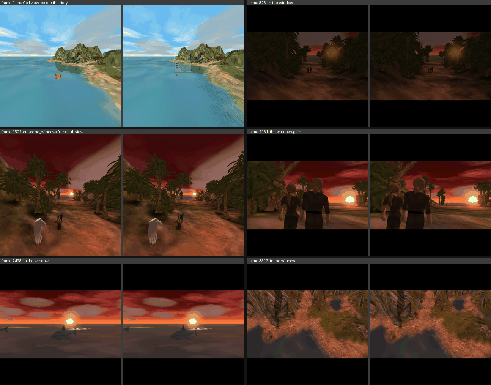

# The cut scene window

In the God view, a cut scene plays on a screen in the room. The full view
closes to a window 2 m ahead of the player, the game shows its cut scene
there, and the full view opens again when the cut scene ends.

This is item 12 of Buck's headset test of 2026-10-03: "what might actually
work better for cutscenes is basically switching to the stereoscopic window
mode for the cutscenes, that way we could actually animate the camera and
frame everything as intended by the game. So when we enter the cutscene, our
field of view would shrink to the 2m rectangle in front of us [...] and when
it's over, the window would grow to return the full immersive FOV for the
player and place them into god mode again."

Before this, a story in the God view played in the full view at the life
size scale. The mod held each shot and cut between the shots
(`script_camera.cpp`), and it hid the cinema bars. Two faults came from that.
The player could not tell a cut scene from play. And the shots lost the
motion and the frame that the game gave them.

Buck tested the first build (`3918f87`) in the headset on the evening of
2026-10-03: "New cutscene system is much better than the teleporting thing we
had going before". His notes are the second round of this file:

| Note | What he saw | Section |
| --- | --- | --- |
| a | The window was at a fixed place in the room. A cut scene could start "to the side", and he had to turn his head | 5.1 |
| b | The subtitles in the picture had "strange depth clashing issues" | 7 |
| c | "the sides of the window are rendering at slightly different locations/depths in both eyes so I can see some ghosting around the sides" | 6 |
| d | Close shots: "some subjects are rendered so close to my face that I have to nearly go cross-eyed to see them" | 6 |
| e | The change into a cut scene and out of it is good, and the God view at the new place is good. They must stay | 3 and 10 |

This file is the design as built on 2026-10-03. The code is in
`src/mod/cutscene_window.cpp` and `cutscene_window_math.h`.

## Summary

- **The signal** is the game's own cinema state: the bars are up
  (`HelpSystem + 0x45E8`). The mod reads it and hooks nothing.
- **The place.** The screen is 2 m ahead of the head of the moment that the
  cut scene starts: at the yaw of the head, level, at the height of the
  recenter pose. It stays there in the room.
- **The enter.** Black walls close around an opening in 0.5 s. The opening
  ends with the size of the opening of the screen: 2.53 m wide and 2.6 m high
  with a square render.
- **The window.** The frame is a frame of play mode 1: the game camera with
  no head on it, the view angle of the game, two eye pictures on one screen.
  The camera glides, pans, cuts and shakes as the game made it. The bars are
  in the picture.
- **The depth.** The screen is a window. Nothing of the scene is in front of
  it, and the eyes are parallel for a point that is far away. The opening is
  one rectangle for both eyes.
- **The subtitles** are on a card in the plane of the screen, under the
  scene. None draws in the picture.
- **The leave.** The next frame is a full view frame, with the God view
  built where the story left the camera. The walls open in 0.5 s. Nothing in
  the view moves while they open.
- **The keys.** `cutscene_window` (1) is the window. `cutscene_face_head`,
  `cutscene_depth` and `cutscene_subtitles` (all 1) are its parts, and 0
  gives each part as it was before. With `test_keys=1`, numpad 0 changes the
  window live and numpad 1 the depth limit.
- **The mouse player** with no headset gets no change.

## 1. The signal

`HelpSystem::SetWideScreen` `0x005C6AD0` puts the cinema bars up and takes
them down. It writes its first argument to `HelpSystem + 0x45E8`: 1 while the
bars are up. `GGame + 0x25005C` is the pointer to the HelpSystem
(`GScript::SetWideScreen` `0x006F7BF0` reads both). The float at
`0x00EB9950`, which `draw_hooks.cpp` uses, is only the share of the bars that
shows now.

The callers of `SetWideScreen` are few:

| Caller | What it does |
| --- | --- |
| `GScript::SetWideScreen` `0x006F7BF0` | The script command `SET_WIDESCREEN`. With the bars up it also turns the interface off (`GInterface::SetActive(0)`), so the game holds the player's input |
| `GInterface::StartPlayBack` `0x005DAD60` | The hand demo. It puts the bars up when they are not up |
| `HelpSystem::Reset`, `ClearDialogueControl`, `ResolveLoad`, `GGame::FinishedVideo`, `PlayFullScreenMovie` | The bars go down |

So "the bars are up" is the game's own mark of a cut scene. The mod reads the
flag once a frame, in `CutsceneWindowEndFrame`.

## 2. The rule

`ScriptCameraStoryOwns` is not the signal. It is true for each camera mode
that is not the player's, and most of those are not cut scenes.

| Case | Bars | Story camera | What the player gets |
| --- | --- | --- | --- |
| A cut scene of a script (`begin cinema`) | Up | Yes | The window |
| The hand demo | Up | Its own camera call | The window |
| A script puts the bars up and leaves the camera | Up | No | The window. The game holds the input, so the God view has no use then |
| A story camera with no bars, for example a camera that follows the Creature | Down | Yes | No window. The God view stands aside, and the mod holds each shot and cuts, as before |
| Play | Down | No | The God view |

Which scenes of the game have a story camera and no bars is not measured.
The two stories of the desktop runs (section 10) both have the bars: the
opening story, and the story that takes the player to the Creature pen.

The rule is `window_math::Wanted`:

1. The window is wanted while the bars are up.
2. After the bars go down, the window stays while a story camera still owns
   the view. A script takes the bars down first and gives the camera back
   after that. If the window went at once, the full view would open on the
   story camera and then jump when the God view came back.
3. A story camera that stays more than `cutscene_window_linger_ms` (3000)
   after the bars is not the end of a cut scene. The window goes. The full
   view then shows the story camera with held shots, as before.
4. A story camera with no bars does not start the window.

The window also needs the God view (`play_mode=4`) and the head on the
camera (`head_camera=1`).

## 3. The sequence

The state is `window_math::State`: `open` from 1 (the full view) to 0 (the
opening has the size of the window), and `flat`.

**The enter.** When the window becomes wanted and the view is open, the
screen takes its place (section 5.1). While the window is wanted and the
frame is not flat, `open` goes down by the frame time divided by
`cutscene_window_ms` (500). The frames are full view frames. Four black walls
go over all the layers of the frame (section 5.3). When `open` is 0, the
frame after that one is flat.

**The window.** A flat frame is a frame of play mode 1 (section 4). It stays
for as long as the window is wanted.

**The leave.** When the window is not wanted, the next frame is a full view
frame, and `open` goes up in the same time. On that first frame the God view
is built at the game camera, with the last scale and the last ground height
(`god-view.md`, section 15). Since 2026-10-04 the land point that the camera
looks at is in front of the player, and the player faces the way that the
camera faces. So the land is in its place before the walls open, and the
player sees no jump after the growth. The player's camera mode brings the
game camera to rest after the story, and that is not a new place for the
view. At `open` 1 the walls are gone.

A cut scene that starts while the view opens closes it again from where it
is, and the screen keeps its place. A frame longer than 35 ms counts as 35
ms, so one slow frame does not jump over the change. A cut scene often starts
with a slow frame, because the game loads its script and its sounds then.

**The change is a view that closes, not a picture that shrinks.** A picture
that shrinks is motion of the whole view, and it needs a second picture of
the game for the time of the change. The walls move, and the world behind
them stays still. The cut from the full view to the screen happens inside
the opening, when it has the size of the window.

## 4. One state for a frame

Hooked functions run many times a frame, and two eye passes must agree. So
the state changes at one place only: `CutsceneWindowEndFrame`, which
`stereo.cpp` calls after a frame went out. The main camera call, both eye
passes and the layers of the next frame all read the same `flat`.

In a flat frame:

| File | What changes |
| --- | --- |
| `head_camera.cpp` | Each camera call goes through as it came: no head, no lean, the game's own pitch. The main call tells `tabletop.cpp` to let go of the frame. `HeadCameraEnabled` gives false, and the reads of the room and of the game camera give nothing |
| `tabletop.cpp` | The God view stands aside, as for a story. It is built again at the first full view frame |
| `script_camera.cpp` | No held shot and no cut: the game moves the camera. A shake plays |
| `stereo.cpp` | The eyes are two cameras side by side (`EyeCameraSetEye`), as in play mode 1. `CutsceneWindowBeginFlat` gives the distance between them and the shift of the flat interface, once, before the eye passes (section 6). The hint cards do not show |
| `cutscene_window.cpp` | The view angle is the game's own (70 degrees), not the angle of the headset. The angle of the headset comes back at the leave |
| `draw_hooks.cpp` | The cinema bars show. The help text has the game's size, not `ui_scale_pct`. The help text goes to the subtitle card (section 7). Each world batch of both eye passes goes to the measure of the nearest thing (section 6.4) |
| `near_plane.cpp` | The game's near plane stays |
| `xr_screen.cpp` | The eye pictures go out as two quads at the opening, not as a projection layer. Each eye shows its picture less the crop (section 6.2). The subtitle card goes over them |
| `controllers.cpp` | A press of the trigger needs no pixel in view. It is a plain click |

Every module that asks `HeadCameraEnabled` gets a no in a flat frame: the
pointer (`pointer_map.cpp`), the spirits (`spirit_anchor.cpp`), the ears
(`audio_listener.cpp`), the teleport and the world lock of the interface.
Each then does what it does in play mode 1. The hands of the mod find no
room (`HeadCameraStageBasis` gives nothing), so they place no Hand and pick
nothing.

The state changes after the frame went out and before the next main camera
call. `EnterFlat` and `LeaveFlat` change the view angle at that same time, so
no frame has one angle in its camera and a different one in its layer.

## 5. The screen, the opening and the walls

### 5.1 The place (note a)

In the first build the screen hung from the recenter pose. A player who had
turned in the room since the last recenter got the cut scene to the side.

Now `PlaceScreen` runs when a cut scene starts with the view open, which is
the frame that the walls start to close in. `window_math::AnchorAtHead` makes
the anchor of the screen:

- The position is the head of that frame along the floor (x and z of the
  middle of the two eyes, in the LOCAL space of the runtime).
- The height is the height of the recenter pose, as before. A player who
  looks down at the land when the story starts gets the screen at eye
  level, not on the floor.
- The yaw is the yaw of the head (`YawOf`). It comes from the right axis of
  the head, which stays level, so a head that looks straight down has a
  yaw. The screen has no pitch and no roll.

`ScreenPose` puts the center of the screen `screen_distance_cm` (200) ahead
of the anchor. After that the screen stays where it is in the room. It never
follows the head: the anchor is a value that only `PlaceScreen` and a
recenter write.

- **The next cut scene** places the screen again, when the view is open at
  its start. A cut scene that starts while the walls are in the view keeps
  the place that the walls have.
- **F11**, and a recenter from the headset menu, put the screen at the
  recenter pose, which is the head of that moment. So F11 still puts the
  screen in front.
- **With no head pose** (no headset and no invented head), and with
  `cutscene_face_head=0`, the screen hangs from the recenter pose as before.
  The log gives the reason.

### 5.2 The screen and the opening

**The screen** is where the two eye pictures are. Each picture is
`screen_width_cm` (260) wide on it, with the shape of the render: a square
render gives 2.6 by 2.6 m. At 2 m, 2.6 m is 66 degrees across. The game
draws 70 degrees, so the picture is very near its true angle.

**The opening** is the part of the screen that has both pictures. With the
depth limit the two pictures are the distance between the eyes apart
(section 6.2), so the opening is that much narrower: 2.53 m for eyes 65 mm
apart. With `cutscene_depth=0` the two pictures are at one place and the
opening is the whole screen, as before.

In `xr_screen.cpp`, `XrScreen::StageWindow` gives the frame a `WindowLayer`.
With `screen` set, `EndFrame` takes the quad path of play mode 1 with the
pose and the size of the opening: one quad for each eye, each visible to its
eye only. Both quads have one pose and one size. The quad of an eye shows the
rect of its picture that is left after the crop (`imageRect`). Past the quads
the runtime shows black.

### 5.3 The walls

**The walls** (`window_math::Walls`) are four quads in the plane of the
screen: top, bottom, left and right of the opening. Each reaches 40 m out, so
together they cover 87 degrees to each side. They share one swapchain of 16
by 16 pixels that holds black. They go last in the frame, over the
projection layer, the panels and the cards. Each wall is one quad for both
eyes.

The opening of the walls is `OpenScale(open)` times the opening of the
screen: 4 times at the full view and 1 time at the window. The scale changes
by the same ratio in the same time, with a slow start and a slow end. 4 times
is 69 degrees to each side, past the edge of the view of a head that looks
at the screen.

A head that looks down at the land already has the bottom wall in view at
the start. So the walls are clear at the full view and become black in the
first part of the change (`MaskAlpha`): black at `open` 0.5 and below.

If the runtime gives no swapchain for the walls, the frames go out with no
walls, and the change is a cut. The log says so once.

## 6. The depth of the picture (notes c and d)

### 6.1 What was wrong

Both notes have one cause [V, the code of build `3918f87`].
`XrScreen::EndFrame` gave the two eye quads one pose, one size and the whole
picture. So the edges of the screen were at one place for both eyes, and the
walls were one quad for both eyes. The fault was not in the edges. It was in
what the pictures held.

The two eye pictures come from two cameras side by side, 0.5 units apart
(the eyes at the life size scale). Such cameras draw each point more to the
right in the left picture. With both pictures at one place of the screen,
the eyes cross for each point of the scene. Only a point infinitely far away
was on the screen, and all the rest was in front of it. For a screen `W`
wide that shows a view of angle `a`, cameras `e` units apart and a point `Z`
units away, the two pictures are `W e / (2 Z tan(a / 2))` apart
(`ScreenDisparity`), and eyes `i` apart see the point `S i / (i + d)` away
(`SeenDistance`):

| Point | Apart on the screen | Seen at |
| --- | --- | --- |
| The horizon | 0 | 2.00 m, on the screen |
| 30 units (4 m at the life size scale) | 31 mm | 1.37 m |
| 15 units (2 m) | 62 mm | 1.04 m |
| 7.5 units (1 m) | 124 mm | 0.70 m |
| 3.5 units, the near plane of the game over high land | 265 mm | 0.40 m |

- **Note d.** A close shot has its subject 4 to 10 units from the camera, so
  the eyes saw it 0.45 to 0.8 m away, in front of a screen that is 2 m away.
  The first reading of this note was that the plane with no parallax was at
  2 m times the scale. That was not so: no depth was on the screen.
- **Note c.** Each edge of the screen cut the two pictures at different
  places of the scene. For a thing 15 units away, one eye saw a strip of 62
  mm at the edge that the other eye did not see, and at the near plane the
  strip was 27 cm. The thing was also nearer than the edge that cut it. A
  real window cannot do that, so the eyes found no depth for the edge.

### 6.2 The stereo of a window

A window shows a world that is behind it. Two numbers make the screen a
window (`window_math`, "THE DEPTH LIMIT"):

**The shift.** The two eye pictures are `shift` meters apart on the screen,
and the picture of the left eye is the one to the left. A point far away is
at one pixel in both pictures, so it is `shift` apart on the screen. With a
shift of the distance between the eyes, the eyes are parallel for it. The
shift is a whole number of pixels (`Crop`), an even number, and never more
than the distance between the eyes. So the eyes never turn out. For eyes 65
mm apart and a picture of 2880 columns on 2.6 m, the crop is 72 columns at
the most, and a point far away is seen more than 50 m away.

**The opening.** The mod does not move a quad for an eye. Each eye picture
loses `crop` columns: the left eye at its left side and the right eye at its
right side. Both quads have the pose and the size of what is left. So the
opening is one rectangle in the room by construction, and each eye picture
fills it to its edges.

**The plane.** The plane is the depth, in world units, that is on the
screen. For cameras `e` units apart, the two pictures of a point `Z` units
away are `shift - W e / (2 Z tan(a / 2))` apart (`Parallax`): 0 is on the
screen, and more than 0 is behind it. `SeparationFor` gives the `e` that
puts `plane` units on the screen: `e = 2 tan(a / 2) shift plane / W`. Eyes
`i` apart then see a point `S i / (i - parallax)` away (`SeenBehind`). With
a shift of the distance between the eyes, that is `S Z / plane`: depth is in
proportion, as through a real window.

| Point, with the plane at 15 units | Seen at |
| --- | --- |
| 15 units | 2.00 m, on the screen |
| 30 units | 4 m |
| 60 units | 8 m |
| The horizon | With parallel eyes |

The scripted camera does not move, and the view angle does not change. The
mod only moves the two eye cameras to the sides of it, by half of `e` each.
So the shot is the shot of the game. Each eye picture loses 72 of its 2880
columns at one side (2.5 percent).

### 6.3 The rule for the plane

`window_math::PlaneTarget`:

1. The nearest thing in view is not in front of the screen. So the plane is
   at 85 percent of the nearest depth in view.
2. The plane is not farther than the screen distance at the life size scale:
   2 m at 7.5 units for each meter is 15 units
   (`cutscene_units_per_meter_x10`). A scene with all its things far away
   then has its true depth, as a real window shows it, and the eye cameras
   are 0.54 units apart.
3. With no measure, the plane is at the near plane of the game. The game
   draws nothing nearer, so that is the worst case: all of the scene is
   behind the screen. The game sets its near plane for each frame. It was
   0.5 to 3.5 units in the desktop runs.

| The nearest thing in view | The plane | Units for a meter of depth | The nearest thing is seen at |
| --- | --- | --- | --- |
| 100 units | 15 units | 7.5 | 13 m |
| 20 units | 15 units | 7.5 | 2.7 m |
| 10 units | 8.5 units | 4.25 | 2.35 m |
| 5 units | 4.25 units | 2.1 | 2.35 m |
| No measure | The near plane, 0.5 to 3.5 units | 0.25 to 1.75 | 2 m or more |

So a close shot does not come out of the screen. Its scene gets less depth:
the eye cameras come nearer to each other, and the subject stays 2.35 m
away.

### 6.4 The nearest thing in view

The game transforms its vertices on the CPU. `LH3DRender::DrawTriangle`
`0x0082F810` gets each world batch as a list of triangles in pixels of the
render, and each vertex has `rhw`: the near plane divided by its depth.
`draw_hooks.cpp` already hooks it. In both eye passes of a flat frame it
gives each batch to `CutsceneWindowProbeBatch` (`window_math::GridBatch`):

- A grid of 16 by 16 cells covers the opening. The part of an eye picture
  that is in view is the columns that the opening shows of it (the left eye
  from the crop to the right edge, the right eye from the left edge to the
  crop before the right edge) and the rows between the cinema bars
  (`BarPixels`, from the bar share at `0x00EB9950` and the scene shape
  0.5625 at `0x008C7A50`). So a thing counts when one eye or the other
  shows it, and a thing that a bar hides does not count.
- Only a vertex that a triangle of the batch uses counts, and it counts one
  time. The game keeps vertices in the array that it did not project: the
  land draw `fn_00874AA0` leaves a vertex that is out of the view frustum
  in camera space (the test at `0x00874E74`), and no triangle uses it. Read
  as a vertex on the screen, it looks like a thing at the near plane. The
  first desktop runs had this fault (section 10).
- Each vertex in that part puts its `rhw` in its cell, and a cell keeps the
  largest.
- A triangle with a vertex out of that part is cut at its edges
  (`GridCut`). `rhw` is linear across a triangle on the screen, so the cut
  gives the true depth at the edge. A vertex out of view does not count, and
  the part of its triangle that is in view does. Without this, a large
  triangle of the land under the camera gives a depth that is too near or
  no depth at all.
- A vertex nearer than the near plane counts as the near plane.
- A batch with an `rhw` of exactly 1 in each vertex is left out. It is a
  draw in screen space with no depth, as the scanline sea of
  `LH3DWater::Draw` `0x00879930` is (`water_mode.cpp`). A mesh cannot have
  all of its vertices on the near plane.

**The nearest depth is the second nearest cell** (`GridNearest`, rank 2).
One stray vertex, or a thing smaller than one cell (4.4 degrees), cannot
make all the picture flat. The margin of 15 percent covers the difference
to the true nearest point of a thing that is in two cells. The log also has
the nearest vertex of all and the caller of its batch.

The measure of a frame sets the depth of the next frame. Only
`DrawTriangle` is measured. A draw that goes through `DrawAndClip` or
`DrawAndClip2D` is not in the measure.

### 6.5 The plane of a frame

A change of the plane changes the depth of all the picture. So the plane
must not pump inside a shot (`window_math::PlaneStep`):

- **A new shot** is a frame in which the camera turned more than 20 degrees
  or moved more than half of the nearest depth (`ShotCut`). The measure of
  the frame before is of the old shot, so the frame of the cut keeps the
  rule of a shot, and the next frame that is not a cut takes the first
  measure of the new shot at once. A cut may snap. A camera that moves fast
  enough to be a cut in each frame keeps the rule of a shot.
- **Inside a shot, a nearer thing takes the plane with it at once.** The
  plane is a latch: it goes to the nearest depth that the shot had, and a
  measure that goes up and down does not move it. A thing that comes nearer
  by 60 units a second stays behind the screen.
- **A thing that went away** must stay away for 2 s. Then the plane goes
  back with a time constant of 4 s. That is slow: less than a quarter of
  its range in a second.
- **The first frame in the window** has no measure, so it has the worst
  case.

`CutsceneWindowBeginFlat` does this once in a flat frame, before the eye
passes. Both passes get one distance between the eye cameras.

### 6.6 The flat interface

A flat interface batch is at one pixel in both eye pictures before the mod
moves it. With the shift of the pictures that would be parallel eyes. So in
a flat frame with the depth limit, each eye moves the interface half of the
crop toward the nose (`ui_shift` of `CutsceneWindowBeginFlat`, in place of
the adaptive shift). The interface is then on the screen, with no parallax,
at each depth of the scene behind it. The crop is an even number, so the
move is a whole number of pixels. The cinema bars cover the whole width of
each picture, so they cover the whole opening.

### 6.7 When there is no depth limit

| Case | What the window does |
| --- | --- |
| `cutscene_depth=0`, and numpad 1 with `test_keys=1` | The stereo of section 6.1, with the whole screen as the opening |
| `cutscene_depth=2` | The plane is at the near plane in each frame, with no measure |
| The mod cannot read the transform or the camera of the game | The stereo of section 6.1. The log says so once |
| A frame with no world batch (a fade to black) | The plane of the frame before |

## 7. Inside the window

**The subtitles (note b).** In the first build the subtitles were in the
picture, at the interface depth, and the scene came out of the screen in
front of them. Now the subtitle card of `ui_panel.cpp` (`ui-layer.md`,
section 17) takes the help text of a flat frame too:

- `SubtitleBeginFrame` latches the route for the frame. In eye pass 0 each
  batch of the HelpText scope and of the subtitle box draws into the panel
  target, and in eye pass 1 it draws nowhere. So no subtitle draws in an eye
  picture. Story speech and advisor speech both come through that scope.
- `CutsceneWindowSubtitleQuad` gives the place (`window_math::SubtitleQuad`):
  in the plane of the screen, at its yaw, with the top of the card 4 cm
  under the scene. The scene of the game is 16 wide and 9 high between its
  cinema bars. On a square screen of 2.6 m that leaves a black bar of 57 cm
  under the scene, and the card is on that bar: its top is 21 degrees below
  eye level. `cutscene_subtitle_place=1` puts the card under the whole
  opening, which is 33 degrees below eye level on a square screen. A render
  of 16 to 9 has no cinema bars: the scene is the whole picture, and the
  card is under the opening.
- The whole width of the render is `cutscene_subtitle_width_cm` (140) on the
  card. That is the letter size of the card in the God view: a letter of 77
  pixels is 1 degree high. A card with more lines grows down, and its top
  stays.
- The card goes out as one quad layer for both eyes, over the two eye
  quads. It is on the screen plane, and the scene is at that plane or
  behind it, so the card and the scene do not clash.
- **One copy.** The card and the picture never both have the text. When the
  card cannot go out (no panel target, the runtime refused its layer, or
  the copy failed three times), the route is off for the frame and the text
  draws in the picture, on the screen plane. `cutscene_subtitles=0` does the
  same.

**The cinema bars** show in the picture. At full size they cover 44 percent
of a square render, so the scene has a wide shape between them.

**The interface, the advisors and the help text** draw as in play mode 1.
The interface is on the screen plane (section 6.6). The advisors are not
fixed in the room, and their sound comes from the game camera. They are in
the measure of the nearest thing: the game puts them 7.5 to 11 units from
the camera [I], so with the advisors in view the plane is at about 6 to 9
units.

**The hands.** The mod places no Hand, draws no glow and no ray, and shows no
hint card. The teleport, the grab of the land, the zoom steps and the far
grab do not act: each needs the room, and a flat frame has none.

**The buttons that a cut scene needs:**

| Button | In the window |
| --- | --- |
| Y on the left controller, or the left menu button | Esc, as before. The game drops Esc while a script holds the cinema bars (`GGame::ProcessKey` `0x0063EF20` tests `HelpSystem + 0x45E8` and `+ 0x45EC`) [V]. So Esc does nothing in a story, on a monitor too, and it opens the menu again after the story |
| The trigger | A left click at the place of the pointer |
| The mouse and the keys | As on a monitor |
| F11 | Recenter. The screen moves in front of the head |

## 8. The keys

All in `[bwvr]`. None is in the launcher.

| Key | Default | Meaning |
| --- | --- | --- |
| `cutscene_window` | 1 | 1 plays a cut scene of the God view on the screen. 0 plays it in the full view with held shots |
| `cutscene_window_ms` | 500 | The time of the close and of the open, 0 to 3000. 0 is a cut |
| `cutscene_window_linger_ms` | 3000 | How long the window stays for a story camera after the bars went down, 0 to 20000 |
| `screen_distance_cm`, `screen_width_cm` | 200, 260 | The screen. The keys of play mode 1 |
| `cutscene_face_head` | 1 | 1 puts the screen ahead of the head when the cut scene starts. 0 puts it ahead of the recenter pose |
| `cutscene_depth` | 1 | 1 keeps the nearest thing in view on the screen or behind it. 2 puts the near plane of the game on the screen in each frame. 0 is the stereo of the first build |
| `cutscene_units_per_meter_x10` | 0 | The largest scale of depth in the window: 10 times the units for a meter. 0 takes the life size scale (`head_units_per_meter_x10`, 75) |
| `cutscene_subtitles` | 1 | 1 shows the subtitles on the card under the scene. 0 keeps them in the picture |
| `cutscene_subtitle_width_cm` | 140 | The width of the whole render on that card, 30 to 400. It sets the size of the letters |
| `cutscene_subtitle_place` | 0 | 0 hangs the card under the scene. 1 hangs it under the whole opening |
| `cutscene_window_capture` | 0 | A test: 1 saves the eye pictures of the second and the 90th frame in the window, and of the second frame after it |
| `cutscene_window_test_off`, `cutscene_window_test_on` | 0, 0 | A test with no key press: at the first frame number the window goes off, and at the second it goes on, as numpad 0 does |
| `cutscene_depth_test_off`, `cutscene_depth_test_on` | 0, 0 | The same for the depth limit, as numpad 1 does |

With `test_keys=1` and Num Lock on:

- Numpad 0 turns the window off and on. Off during a cut scene opens the
  full view at once, with held shots. On during a cut scene closes it.
- Numpad 1 turns the depth limit off and on, for a live comparison in one
  shot. Off is the stereo of the first build.

## 9. The log

These lines are from the desktop run cw2b of section 10 (a render of 2560 by
1440, and a head that looks 30 degrees to the left when the story starts):

```
cut scene    : cutscene_window=1. In the God view a cut scene plays on a screen in the room
cut scene    : the screen is 2.60 m wide, 2.00 m ahead of the head at the start of the cut scene (cutscene_face_head=1). The view closes and opens in 500 ms.
cut scene    : cutscene_depth=1. The nearest thing in view is on the screen or behind it
cut scene    : cutscene_subtitles=1. The subtitles show on a card under the scene
cut scene    : frame 630: the cinema bars are up, and a story camera owns the view
cut scene    : frame 630: the screen goes ahead of the head: the head is at 0.25 0.00 -0.10 m with a yaw of 30.0 degrees, and the screen is level at a height of 0.00 m (the recenter pose has a yaw of -0.0 degrees)
cut scene    : frame 630: a cut scene starts, so the view closes to the window
cut scene    : frame 675: the view is the window now. The game camera moves as the game made it, with the game's view angle (the full view had 110.0 degrees)
subtitles    : frame 675, the subtitle card hangs under the scene of the cut scene window, and no subtitle draws in its picture
cut scene    : frame 675: the first frame in the window has the worst case. No measure of the nearest thing. The screen plane is at 3.5 units: 1.75 units for each meter of depth (at most 7.5), and the eye cameras are 0.123 units apart
subtitles    : frame 675, the subtitle card under the cut scene window: the rect 480 1216 624 176 of the 2560 by 1440 render, 312 by 88 px on the card, at -0.981 -0.819 -1.699 m, turn 0.0000 0.2588 0.0000 0.9659, 0.34 by 0.10 m. The copy took 1.26 ms
cut scene    : frame 675: the eye pictures are on the screen, 2.54 by 1.46 m at -0.75 0.00 -1.83 m, turn 0.000 0.259 0.000 0.966 (no headset, so no layer)
cut scene    : frame 675: each eye picture loses 64 of its 2560 columns, so the two pictures are 65.0 mm apart on the screen, for eyes 66.8 mm apart. The opening is the same 2.54 m for both eyes
cut scene    : frame 3936: the cinema bars are down, and the player's camera owns the view
cut scene    : frame 3936: the cut scene is over (the bars are down and the camera is back)
cut scene    : frame 3937: the window ends. The full view is built again, and the walls open
god view     : your camera is back, so the God view is too
god view     : the land at 2238 16 3156 is under you, 0.60 m below your head. The view faces heading 54.8 degrees at 100.0 units per meter.
subtitles    : frame 3937, the cut scene window is gone, so the subtitle card has its place in the room again
cut scene    : frame 3980: the full view is open again
```

Since 2026-10-04 the line of the build after the window is "god view : the
view goes to the game camera (the end of a cut scene)", with the game
camera, the waist point before and after, and the place of the look point
(`god-view.md`, section 15.8).

The depth of the picture has one line for each change of state, with the
numbers of that frame. These are from run cw9:

```
cut scene    : frame 673: a new shot. The nearest thing in view is 44.0 units away (the nearest vertex 44.0, from 0x00875627). The screen plane is at 15.0 units: 7.50 units for each meter of depth (at most 7.5), and the eye cameras are 0.525 units apart
cut scene    : frame 1268: the nearest thing went away in the shot. The nearest thing in view is 31.6 units away (the nearest vertex 29.4, from 0x00875627). The screen plane is at 12.0 units: 6.02 units for each meter of depth (at most 7.5), and the eye cameras are 0.422 units apart
cut scene    : frame 1597: a thing came nearer in the shot. The nearest thing in view is 13.6 units away (the nearest vertex 13.6, from 0x0084C3A1). The screen plane is at 11.6 units: 5.78 units for each meter of depth (at most 7.5), and the eye cameras are 0.404 units apart
cut scene    : the screen plane was at 8.1 to 14.0 units this report (4.03 to 7.00 units for each meter of depth). 450 frames had a measure of the nearest thing, and 0 shots started. The nearest thing was 9.5 units away at the least and 12.7 units in the last measure.
```

- **The nearest thing in view** is the measure: the second nearest cell.
  **The nearest vertex** is the nearest cell, and the address is the code
  that drew it (the return address of its `DrawTriangle` call).
- **A new shot** is the first measure after a cut, when the plane changes by
  more than 5 percent. **A thing came nearer** and **the nearest thing went
  away** are changes inside a shot, one line for each 15 percent.
- **The report** (each 450 frames) has the range of the plane, the frames
  with a measure, the shots, and the nearest depth at the least and in the
  last measure.
- A test key gives `test key : cutscene_depth=0` or `=1`.

Each frame of a change has a line with `open`, the size of the opening and
the place of the screen. With no headset the lines end with "(no headset, so
no layer)". The log has at most 600 lines for the state, 540 lines for the
frames of a change, and 400 lines for the depth.

## 10. Tests

**The math test** (`test/controller_math`, `window_checks.h`) has 153 checks
of the window, and all 1676 checks passed on 2026-10-03:

- The rule, the state, the shrink, the screen pose, the walls and the stereo
  with no depth limit: the 61 checks of the first build.
- The place: the yaw of a head, also of a head that looks 60 degrees down,
  the anchor at the head along the floor with the height that the caller
  gives, and a screen that is 2 m ahead at that yaw, level, with its front
  toward the head.
- The depth limit: the crop is 72 columns of 2880 for eyes 66.8 mm apart,
  it is an even number, and no render size from 640 to 4096 and no eyes from
  54 to 76 mm give a shift of more than the eyes. A point at the plane has
  no parallax, each point past it is behind the screen with eyes that do not
  turn out, and with an exact shift 30 units are seen at 4 m and 60 units at
  8 m.
- The rule for the plane, and the plane of a frame at 90 frames a second:
  the first measure and a new shot snap, a nearer thing takes the plane at
  once, a thing that went away changes nothing for 2 s and then less than a
  quarter of the range in a second, a measure with 10 percent of noise moves
  the plane less than 2 percent, and a thing that comes nearer by 17 or by
  60 units a second stays behind the screen.
- A new shot: a turn of 25 degrees or a move of more than half of the
  nearest depth, and not a turn of 10 degrees or a glide of 1 unit.
- The nearest depth: a triangle in view, a triangle out of view, a vertex
  behind a cinema bar with the part of its triangle that is in view, a
  triangle that covers the view with no vertex in it, a vertex nearer than
  the near plane, one stray vertex, a draw in screen space, a vertex that no
  triangle uses, a vertex that two triangles share, and the columns of each
  eye.
- The subtitles: the card under a square scene and under a wide one, its
  width, its top, a rect at the left, and a screen that is turned.

**Desktop runs of the first build** (2026-10-03, afternoon) used
`window_wait.ps1` in the scratchpad: the rig of `backend.md` with
`play_mode=4`, `-NEWGAME` on Land 1, the fake controller,
`cutscene_window_capture=1` and the 2880 by 2880 render. The rig has no
headset. So no layer went out, and the log and the eye pictures are the
proof. The rig ran at 52 to 62 frames a second.

| Run | What it showed |
| --- | --- |
| win1 | The opening story. Only the OK button of the start dialog gets a click, so the game starts normally. The bars go up at frame 514, the view closes in 27 frames, and frame 542 is the first in the window. The view angle goes from 110 to 70 degrees. To the end of the run (3950 frames) each main camera call went through with no head, the God view owned 0 frames, the ears were on the game camera, and the mod placed no Hand. The fake Y button sent Esc at frame 3501, in the window, and the story went on (section 7) |
| win2 | The start "Skip straight to the Creature select". The story to the Creature pen: bars up at frame 610, in the window from frame 632 to 2979 (41 s). Frame 2980 is a full view frame with the God view at the pen ("the land at 2238 16 3156 is under you", heading 54.8 degrees, 100 units per meter). The full view is open at frame 3005 |
| win3 | The opening story, with `cutscene_window_test_off=1500` and `cutscene_window_test_on=2100`: the window ends at frame 1501 with held shots in the full view, and the view closes again at frame 2100. The pictures are in `images/cutscene-window-run.png` |
| win4 | The start of run win2 again. The opening goes from 10.20 m to 2.61 m in 23 frames, with no step of more than 7 percent of the change. In the window from frame 633 to 2994. Frame 2995 is a full view frame with the God view at the pen, and the full view is open at frame 3025 |



**The eye pictures of the first build** prove the cause of notes c and d.
Frame 2903 of the combined run all5 (build `3918f87`, the Creatures at the
pen, in the window) was matched in blocks of 48 pixels between the two eye
pictures (`cutwin_disparity.py` in the scratchpad):

- Each of the 268 blocks was more to the right in the left picture: by 6 to
  127 pixels, 50 at the median. So all of the scene was in front of the
  screen, and the nearest block was seen 0.74 m away.
- At the left and the right edge the two pictures differed by 6 to 118
  pixels, which is 0.5 to 10.7 cm on the screen.
- The cinema bars were black in each column of both pictures, and the scene
  had light in the columns 0 to 2879 of both. So each eye picture did fill
  the quad to its edges. The fault of note c was not in the edges.

**Desktop runs of this change** (2026-10-03, 20:45 to 21:08). Buck was at
the PC and said "test now", so the runs cw1 to cw4b did not wait for an idle
PC. The runs cw9 and cw10 ran on an idle PC. The game rendered 2560 by 1440
(16 to 9, so with no cinema bars) at 84 frames a second. The build was the commit "Measure the nearest thing of the cut scene
window in both eyes".

| Run | What it showed |
| --- | --- |
| cw1, cw2, cw4 | No window. The points of the fake hand were made for the 2880 by 2880 render, and in the 2560 by 1440 render the two clicks missed the buttons of the start dialog by a few pixels. The dialog stayed up |
| cw1b | No window. The points were right (new points for the render size), and the game was not in front, so the mod sent no click |
| cw2b | The story to the pen, with `subtitle_card_test=1`, `subtitle_selftest=1`, and a head that looks 30 degrees left and 20 degrees down from 25 cm to the right when the story starts. The lines of section 9. **The place:** the screen is at -0.75 0.00 -1.83 m with a turn of 30 degrees, which is 2 m ahead of the head at 0.25 0.00 -0.10 m at its yaw, level, at the height of the recenter pose. **The enter:** bars up at frame 630, the first flat frame is 675. **The opening:** 2.54 by 1.46 m, each eye picture less 64 of 2560 columns. **The subtitles:** the two test lines go to the card at -0.981 -0.819 -1.699 m, 0.34 by 0.10 m, in the plane of the screen and 4 cm under the scene. In the eye pictures of frames 803 and 1303 the rect of the test lines has no white pixel, and the picture of the card has 346. **The leave:** the bars go down at frame 3936, frame 3937 is a full view frame with the God view at the pen ("the land at 2238 16 3156 is under you", heading 54.8 degrees, the place of run win2), and the walls open in 44 frames at the place of the screen. The next three reports have the waist point at 2238.3 16.1 3155.7 with 0 steps: no jump after the growth |
| cw4b | The opening story. Bars up at frame 529, the first flat frame is 569, and the window stays to the end of the run (frame 5500). The head looked straight ahead, and the screen is at 0.00 0.00 -2.00 m. The game showed no subtitle in this story on the desktop |

**The fault that runs cw2b and cw4b showed.** The measure of the nearest
thing was wrong. It gave the near plane of the game (0.5 to 3.5 units in
these runs) in almost each frame, from the land draw `fn_00874AA0`. In the
eye pictures of 12 frames in the window, no block was in front of the
screen, and the parallax was never more than the crop. But the scene was
nearly flat and far: the nearest block was seen 7.4 to 74 m away. Frame 2203
of cw2b had the depth limit off for the test: there 271 of 279 blocks were in
front of the screen, the nearest was seen 0.70 m away, and its depth was 7.5
units. So the true plane was near 6.4 units, and the measure gave about
1.5.

The cause: the land draw does not project a vertex that is out of the view
frustum (the test at `0x00874E74`). That vertex keeps its camera space values
in the vertex array, and no triangle of the batch uses it. The measure read
each vertex of the array. The commit "Measure only the vertices that a
triangle of the batch uses" reads the triangles (section 6.4).

**The runs with the corrected measure:**

| Run | What it showed |
| --- | --- |
| cw9 | The recipe of cw2b again. The place, the opening and the card are as in cw2b. In the window from frame 672 to 3850, and frame 3851 is a full view frame with the God view at the pen (2238 16 3156, heading 54.8 degrees). The full view is open at frame 3894, and the next four reports have the waist point at 2238.3 16.1 3155.7 with 0 steps. **The measure:** 44.0 units in the first shot, so the plane is at the life size limit of 15.0 units and the eye cameras are 0.525 units apart. After that the nearest thing is 2.9 to 32 units away, and the plane is 2.5 to 14 units. The log has 39 lines for the depth in 3179 frames |
| cw10 | The recipe of cw4b again: the opening story, with its close shots. The nearest thing is 0.9 to 7.7 units away for the first 4700 frames (the near plane of the game is 0.5 to 1.2 units there), and the plane is 0.8 to 6.6 units. The log has 51 lines for the depth in 4833 frames |

**The eye pictures agree with the measure.** A thing `Z` units away is
`crop * plane / Z` pixels more to the right in the left picture. The same
block match as for the first build gives:

| Capture | The measure and the plane | The largest difference that follows | In the pictures |
| --- | --- | --- | --- |
| cw9, frame 673 | 44.0 units, plane 15.0 | 22 pixels | 21 |
| cw9, frame 1803 | 12.7 units, plane 8.2 | 41 pixels | 42 |
| cw10, frame 2003 | 2.9 units, plane 2.0 | 44 pixels | 45 |

**Nothing is in front of the screen.** In the 12 captures in the window of
cw9 and cw10 that have a scene (7 to 799 blocks each), no block is in
front of the screen. The largest parallax is the crop, within the 1 pixel
of the match (64 pixels, which is 65.0 mm on the screen for eyes of 66.8
mm). In frame 2203 of
cw9 the depth limit was off for the test: 565 of 566 blocks are in front of
the screen, and the nearest is seen 0.80 m away.

**A close shot.** Frame 4403 of cw10 is a close shot of two villagers. The
nearest block is seen 2.40 m away, which is the 2.35 m of the rule. In the close shots of frames 1203, 2003 and 2803
it is 3.08, 2.81 and 3.31 m.

**The plane stays near for a time.** In cw9 the camera flies low past trees
and hills. A thing that comes near takes the plane with it, and the plane
then waits 2 s and goes back slowly (section 6.5). So in the captures of
cw9 the nearest block is seen 3.0 to 11 m away, and not 2.35 m: the scene is
behind the screen with less depth than the rule allows. At frame 2886 the
plane was 3.0 units while the nearest thing was 15 units away, and at frame
3124 it was 3.9 units for 22 units.

**Not shown by a desktop run:** the layers (section 11), a real subtitle of
a story on the card, and the keys numpad 0 and numpad 1 (the tests `cutscene_window_test_off` and
`cutscene_depth_test_off` do what the keys do).

## 11. Not built, not tested, and what needs the headset

- **How much depth a shot keeps** after a near thing left it (section 10,
  "The plane stays near for a time"). The two times of the rule (2 s and
  4 s) are constants of `window_math::DepthRule`, with no ini key. Shorter
  times give more depth and a change that shows more. Only the headset can
  say what is right.
- **Needs the headset:** all of the layers. The walls, the two eye quads
  with their crop, the black past them and the subtitle card over them go
  out only with a headset. No run has shown them. The runtime of Buck's
  headset showed the subtitle card and the hint cards as quad layers over a
  projection layer on 2026-10-03, and it showed the two eye quads of the
  first build. A quad that shows a part of its picture (`imageRect`), and a
  card over the eye quads, are new for it.
- **Only the headset can show** whether the opening reads as one solid
  rectangle now, whether a close shot is comfortable, whether the scale of
  a close shot (the eye cameras nearer to each other) looks right, and
  whether the change of the depth at a cut and at a thing that comes near
  shows. Numpad 1 gives the comparison with the first build in one shot.
- **Also for the headset:** the place of the screen when a story starts
  while the head looks down or to the side, and the size and the place of
  the subtitles under the scene (21 to 26 degrees below eye level for two
  lines).
- **A thing smaller than one cell of the grid** (4.4 degrees) can be in
  front of the screen: the nearest depth is the second nearest cell.
- **A draw that does not go through `DrawTriangle`** is not in the measure.
  Which draws of the scene those are is not measured. The log names the
  caller of the nearest vertex, so a log of a shot shows what set its
  depth.
- **The advisors** are in the measure. While they are in view the scene
  behind them has about half of its life size depth. A depth of their own
  for the advisors (on the screen plane, as the interface) is not built.
- **A thing that comes into view inside a shot** takes the plane with it in
  one frame. That is a step of the depth of all the picture, with no
  motion of the picture itself. It then goes back slowly. How that looks is
  for the headset.
- **The frame of a cut** has the plane of the shot before, for that one
  frame.
- **A skip of a story is not built,** and Buck does not want one. His
  item 10 is the skip of the logos at the start of the game (`intro.md`,
  section 11). For the record, the game has no input that ends a story
  [V]. `GGame::ProcessKey` drops Esc while a script holds the bars. The game
  can cut one line of speech: `HelpSystem::ProcessInterface` `0x005C69B0`
  does it for a left click on a line that is 0.5 s old, and for the key
  byte of numpad Enter (`0x00E85410`).
- **Not tested on the desktop:** a real subtitle of a story (the desktop
  game showed none), the hand demo, a load in a cut scene, a click of the
  trigger on a dialog in the window, a recenter in the window, and the
  linger rule (in each run the bars and the camera came back in the same
  frame).
- **A recenter from the headset menu** moves the recenter pose of the mod
  (`XrScreen::TakeRecenter`), so the screen moves with it.
- **Menus and loading screens in a cut scene** go through the mono path, as
  before. That path uses the place of play mode 1 for its screen, which is
  the origin of the LOCAL space and not the place of the window. The Esc
  menu cannot open in a story (section 7).
- **The table** (play mode 3) has no window. Its stories play on the table,
  as before.
- **A picture that shrinks** in place of the walls is not built (section 3).
- **The gradient bars** of item 12 are not built. They were the choice for
  the case that the window fails.
